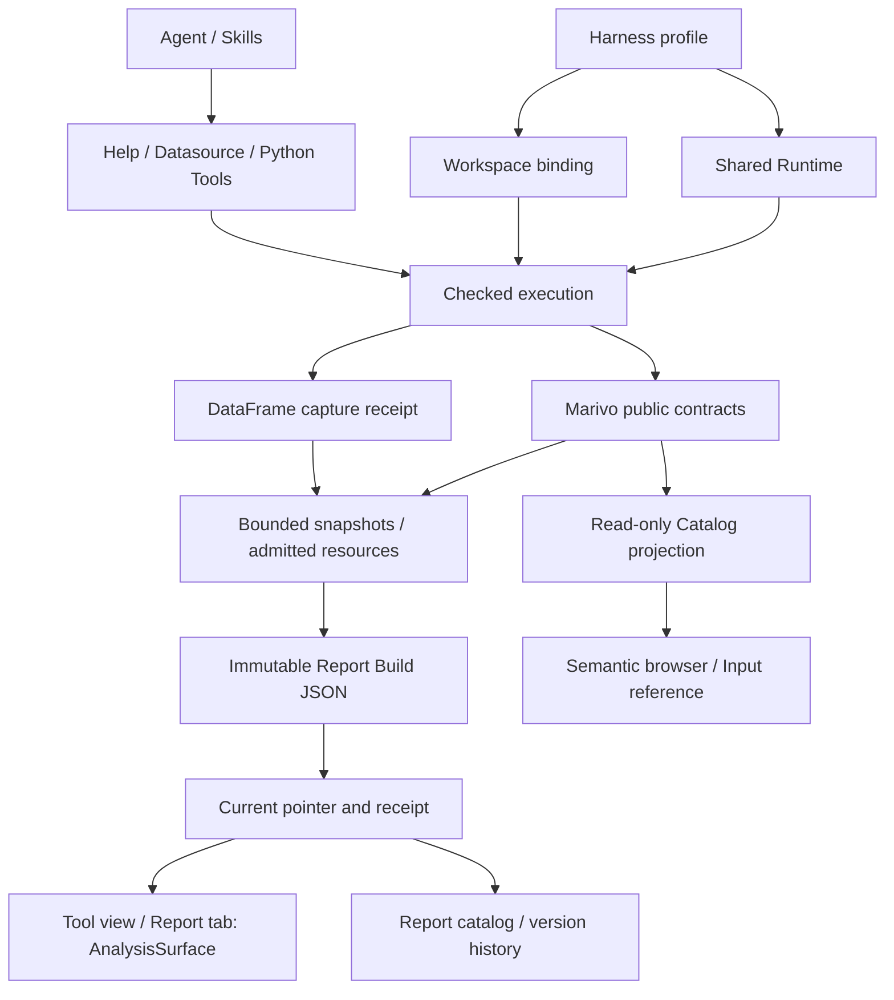

# DSH Data Analysis 总体架构

## 目标与责任边界

`dsh-data-analysis` 是将 Marivo 接入 DeepSeek Harness 的 TypeScript 插件。项目设计以当前代码和上游公开契约为准；模块文档描述实现边界，不代表已安装 profile 或发布版本已经通过真实验收。

| 所有者 | 职责 |
| --- | --- |
| DeepSeek Harness | Agent 编排、Session/Turn、Tool/Skill 生命周期、Credentials、profile、Workspace、附件、输入框和原生 Tab |
| Marivo | 分析语义、Catalog、Artifact、Finding、Evidence、Quality、Lineage、revalidation 与分析 Session |
| 本插件 | Runtime/Workspace binding、受控执行与凭据注入、实时 Help 披露、语义引用及只读投影、报告保存与呈现、打包验证 |

插件使用公开实时接口，不复制 Marivo schema、API registry 或领域推理，不改变 Harness 原生生命周期。分析与展示保存是独立操作；展示保存成功不能证明分析正确。`dsh.analysis-ui/v1` 已保存版本可导出为离线 HTML；对象存储发布不受支持。

## 模块导航

| 领域 | 项目级设计 | 主要边界 |
| --- | --- | --- |
| 运行基础 | [Runtime 与 Workspace](modules/runtime-workspace.md) | profile 共享安装、Workspace 隔离与绑定身份 |
| 运行基础 | [Environment 执行](modules/environment-execution.md) | checked runner、子进程、预算、取消与脱敏 |
| Agent 接入 | [实时 Help 披露](modules/help-disclosure.md) | live Help transport、Skill 激活与上下文恢复 |
| Agent 接入 | [数据源与凭证](modules/datasource-credentials.md) | 配置续接、凭据管理、连接测试与一次 Python 执行准入 |
| Agent 接入 | [Python 工具卡片](modules/python-tool-card.md) | 冻结调用快照的代码与输出展示，不执行或重放分析 |
| Agent 接入 | [文件分析 Skill](modules/file-analysis-skill.md) | 原生附件路径、pandas/DuckDB 与结果交付 |
| 语义交互 | [语义对象引用输入](modules/semantic-reference-input.md) | Catalog 检索、原子引用、提交核验与热度 |
| 语义交互 | [只读语义浏览器](modules/semantic-browser.md) | Catalog 快照、公开定义与声明关系 |
| 报告 | [展示 Skill](modules/presentation-skill.md) | 自定义报告和看板的 Lang 组合与叙事检查 |
| 报告 | [展示数据投影](modules/presentation-projection.md) | 有界快照、Frame 读取、DataFrame capture 与数值预算 |
| 报告 | [展示交付](modules/presentation-delivery.md) | Report/Build、原子保存、语句 patch、current、receipt 与 RPC |
| 报告 | [分析文档 reader](modules/presentation-reader.md) | 共享 AnalysisSurface、报告目录与版本历史 |
| 前端 | [插件私有 UI 组件](modules/custom-ui-components.md) | 主题角色、控件、结果外壳、容器布局与 Host 弹层接入 |
| 报告 | [报告 HTML 导出与发布](modules/report-publishing.md) | 固定版本离线导出；对象存储发布不可用 |
| 插件交付 | [插件集成与交付](modules/plugin-integration-delivery.md) | 安装回滚、资源关闭、Host 接缝、兼容与分发 |

模块文档承载具体协议和失败边界；本文只描述跨模块关系。验证命令以根目录 `package.json` 的 scripts 为准；
`docs/testing/` 中的验证指南和验收记录是本地工作材料，不纳入版本控制。

统一分析 UI 通过 `marivo_present` 保存 `dsh.analysis-ui/v1` 文档。Frame v2 在原 Python 执行中由 `capture_frame`
捕获，DataFrame 由 `capture_dataset` 捕获。快照内嵌不可变 Build，AnalysisSurface
用于隔离候选、tool view 和显式报告 tab。保存校验与呈现分别共用 `resolveFrameView` 与 `resolveDatasetView`；Frame v2 按结构选择视图，
并可在 Catalog 范围内显式指定图形。DatasetView 支持 auto/table/metric 及显式列映射的 line/area/bar/heatmap。旧格式报告不进入报告目录；
新格式支持离线 HTML 导出，不提供对象存储发布或页面编辑。详细契约见本目录中的投影、交付与 reader 模块文档。

## 运行与数据流

### Runtime、Workspace 与 Agent

profile 共享精确安装的 Marivo Runtime、presentation-kit 和 Runtime Skill。Workspace 惰性解析 project root 与 binding，绑定过程不创建项目文件；使用领域能力时由 Marivo 执行相应准入。每次 checked execution 在实际子进程中复核解释器、包位置、版本和 marker，身份不匹配明确失败。

Help 使用启动时验证的 shared Runtime，不为读取 API Help 初始化 Workspace。涉及数据源、分析和展示来源的操作使用所属 Workspace 的同一 bound Runtime。Workspace ID 与 Runtime fingerprint 共同约束浏览和引用身份；同路径重新注册的 Workspace 不能接收旧引用。

每个 Agent 独立持有 Skill 激活、Help 可见性和操作生命周期。普通问题使用文字；文件任务加载 `dsh-data-analysis-files`，已有快照可直接展示，自定义布局按需加载 `dsh-data-analysis-presentation`；需要 Marivo 分析或语义编写时加载 Runtime 的 `marivo-analysis` 或 `marivo-semantic` 并查询 live Help。项目 HTTP 服务任务在 Runtime 提供时加载 `marivo-service`。

默认跨边界 Tool 为 `marivo_help`、`marivo_datasource_configure`、`marivo_datasource_test`、`marivo_python`、`marivo_present`、`marivo_ui_read`。持久化 Frame、Session resume、readiness 和 source inspection 由 Agent 使用 Marivo 公开 API，不另加 convenience wrapper。

### 配置与执行

Harness Credentials 是秘密值权威；Marivo 的公开 description、DatasourceSpec 和 resolver 拥有字段及使用语义。插件配置与表单只保存凭据引用，秘密值通过 Harness 接口管理。

`marivo_datasource_configure` 将表单绑定到原调用与所属 Session，用户完成配置后续接；取消或身份变化结束旧操作。`marivo_python` 在一次调用内等待所有声明的数据源就绪，取得 fresh snapshot，通过 stdin 和 `md.credential_scope` 注入，再交给 Harness Shell 前台执行。秘密值不进入 Agent 参数、argv 或环境，输出在 Host spill 前脱敏。

纯文件分析使用 `datasources: []`，仍保留 Runtime/Workspace identity、取消与执行代码记录。
需要保留 DataFrame 时可在原 marivo_python 中显式 capture_dataset；Host 校验后将快照绑定准确 Workspace/调用/codeRef，Reader 只读快照。每次调用是独立 Python 进程，临时表和内存状态不会跨调用保留；文件结果不会自动获得 Marivo Evidence 或 lineage。

`marivo_python` 使用 Host `ShellExecutor.execute(spec).result()` 完成前台调用。用户要求交付已有 CSV、TSV、XLSX 等表格文件时，文件分析 Skill 指导 Agent 在确认文件后调用 Harness 原生 `present`；文件卡片、Session 文件声明及只读表格预览由 Harness 拥有。插件的 `marivo_present` 承载需要在分析 UI 中核对的表格；原生 `.xls` 预览不扩大 Marivo 的分析格式范围。

### 语义浏览与输入

语义浏览器从公开 Catalog 生成一次元数据快照，列表、定义和关系图共用该快照，不执行 observe、preview、连接测试或凭据读取。声明关系不等同于执行血缘，也不证明查询组合有效。

`@` 与详情页“加入提问”使用同一原生 reference 和 codec。显式选择可准备绑定；提交只核验已有 Session/Workspace 与 binding，不隐式修复旧引用。Harness 拥有输入 revision、原子插入、撤销、附件与发送；迟到结果不得写入下一条草稿。

### 报告保存与阅读

Agent 将原分析进程内 capture 的 Frame、DataFrame 或 Workspace 图片通过资源引用交给 marivo_present。
自定义布局使用 Lang；未变化快照直接复制到新 Build，不重新分析。Report ID 是稳定身份，Build ID 是不可变版本，
recordId 编码这对身份。更新传 basedOnRecordId 和变化语句，官方 mergeStatements 合并后校验完整文档，
再复用既有锁与 current 条件提交；过期基版本失败，不自动覆盖或重试。

默认工具结果使用会话级 Chat 节点，保持在 Harness 工作步骤折叠区之外；明确报告/dashboard 使用 tab。
Native 的公开 PartialArguments 提供真实 program 前缀；
候选只展示安全内容、占位与已授权基版本快照，无业务读取或正式保存。报告候选绑定准确调用，成功后转为固定 Build，
失败或取消保留旧版本。PTC 依实际 dispatch 和结果交付，历史回放不抢焦点，Headless 只确认保存事实。

报告目录与版本历史只读取 current v4 指针及 `dsh.analysis-ui/v1` 记录；current v2/v3 不再读取或更新，文件不删除、不迁移。旧格式（Presentation Document v3）文件保留在磁盘但不再列出，
打开旧地址显示不支持的报告错误，不回退到旧 Reader。Frame v2 的 AnalysisFrameView 按 Frame 结构选择观察、成员、比较、
分解、对齐、相关或份额视图，也接受 Catalog 声明的 line、area、bar、pie、heatmap、comparison 和 decomposition 视图；
DatasetView 支持 auto/table/metric 及显式列映射的 line/area/bar/heatmap。Frame 和 Dataset 均支持选择已保存图点或支持的单元格后“就此提问”。
两种数据视图使用 shadcn/ui 结果外壳与 Recharts 图形，领域层保留事实解释与原始行字段绑定；OpenUI Lang / Renderer 负责报告编排，
八组件的私有布局、主题和交互由[插件 UI 基础层](modules/custom-ui-components.md)统一承载。
全局筛选、页面编辑、对象存储发布及旧报告 cell 的“加入提问”接口均不提供。

## 生命周期与失败原则

原生 Tab 的状态由 Session/Tab occurrence 拥有，导航携带完整 Workspace 和资源身份。关闭、Session 切换、Workspace 撤销和连接重置取消相关请求，迟到响应不能恢复旧页面或草稿。

已有 Agent 批量安装失败时回滚本批安装，后续 Agent 失败只清理自身。插件关闭先同步撤入口并取消，再等待拥有的 Help、Python、present、RPC、凭据、Catalog 和 usage 写入结束，最后释放共享资源。取消等待不证明远端查询已回滚；响应丢失时保留结果未确认状态，不猜测清理。

文件读取按 Host 推导的 Workspace 路径校验真实路径、类型、字节预算与 digest；摘要用于完整性，不能代替授权。共享 Runtime、per-Workspace binding、Agent 操作与浏览器状态分别由各自 owner 释放，已提交报告不随插件卸载删除。

## 语言责任边界

Harness locale 服务拥有插件操作界面的语言设置及持久化；插件仅注册词典并订阅更新。报告展示语言由 marivo_present 的 locale 固化，创建默认 zh-CN，更新省略时继承，不读取系统 locale。Reader 遵循同一报告语言，详见 [报告阅读器](modules/presentation-reader.md#界面语言与报告语言)。

## 插件设置

Harness 拥有设置持久化、配置分层和 revision 冲突检测。插件通过 `dsh-data-analysis` settings namespace 与 `settings.plugin.item` 卡片提供 `pythonTimeoutMs`，在每次 Python 调用入口读取，不重新绑定 Runtime 或 Workspace。界面、继承和生效语义见[超时与执行反馈](modules/datasource-credentials.md#超时与执行反馈)。

## Marivo 0.6 接缝

当前精确版本为 PyPI 正式版 `0.6.3`，安装与升级见 [Runtime 安装](modules/runtime-workspace.md#正式版安装与升级)。
数据源读取统一使用绑定 Workspace 的 `md.load()`；凭据请求只有身份与字段，取消由 Harness 执行边界负责。
Catalog 改用公共分页搜索和 captured definition，允许 Marivo 写入搜索分页缓存；已有文件保持不变。
Frame 展示使用原分析进程中的 `capture_frame()` 快照。新 SQL 来源暂不可用，不读私有接口；已保存 Build 与旧 Store 保留。
Skill 激活使用 Harness 当前选择的正文，并在注入 Runtime Help 前核对绑定包正文；冲突与无法验证的情况见 [Help 披露](modules/help-disclosure.md#skill-激活式根-help)。
