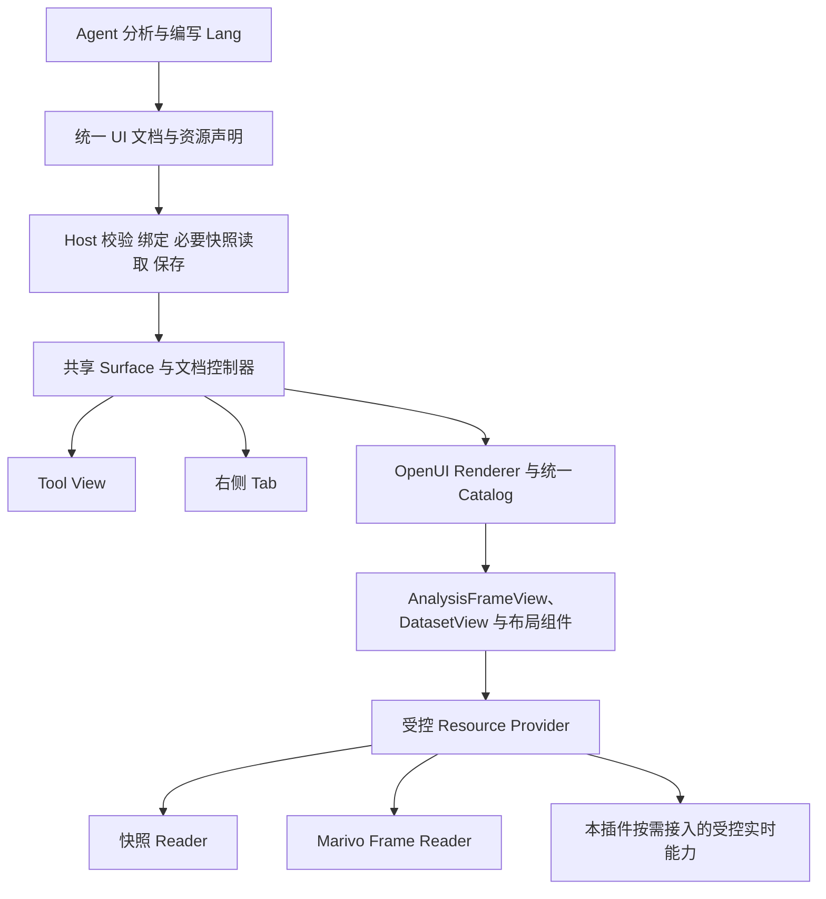
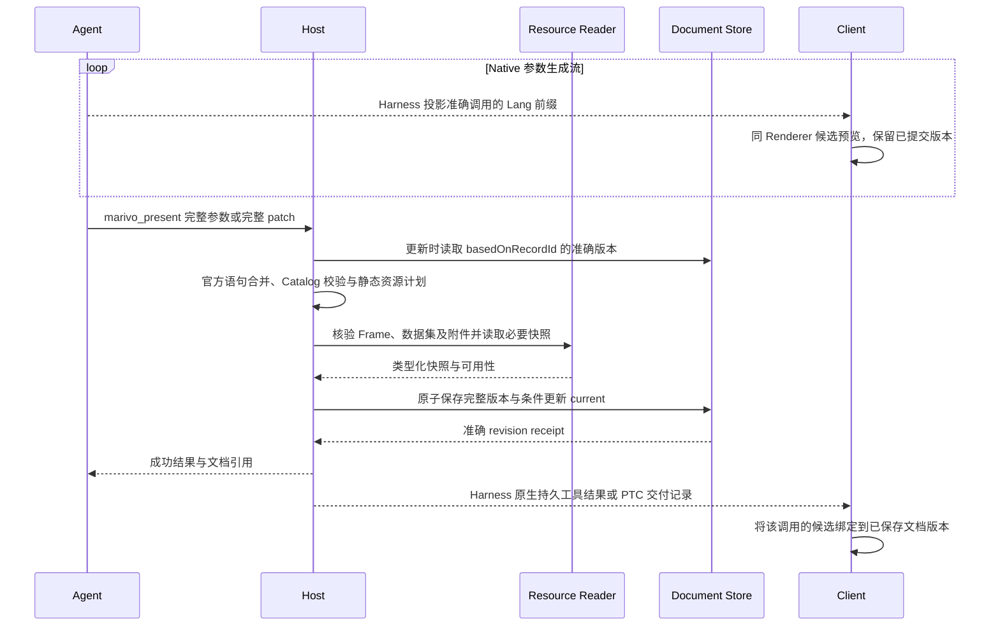

# dsh-data-analysis 统一分析 UI 重构设计

## 状态与设计决策

实施进展（2026-10-28）：[P0 接缝与最小 Catalog 已验证](../testing/unified-analysis-ui-p0-2026-10-28.md)，领域组件仍为占位，P1 数据入口已实现，P2–P3 待实施。下文源码审阅与“未实施”说明保留其初稿时点；当前接线范围以实施计划和该验收记录为准。

状态：P0/P1 已验证，P2–P3 待实施。创建日期：2026-10-27；更新日期：2026-10-28。

阶段任务、最小实现方式及验收安排见[分阶段实施计划](unified-analysis-ui-implementation.md)。设计中的 S0/S1 在实施计划中拆为 P0–P3，后续增强不作为首期完成条件。

本设计只重构 `dsh-data-analysis`。`dsh-intelligent-ui` 是设计与实现参考，不是修改对象、运行时依赖或需要合并发布的插件。本文保留原文件名以便继续引用；“统一”指本插件内部的分析展示能力统一，不合并两个仓库或插件生命周期。

当图形化 UI 组件有助于用户理解、比较或检查数据时，使用 `marivo_present`；文字已足够清楚的答案直接回复。需要 UI 的普通分析在 Harness 的 tool view 中展示；用户显式要求分析报告或 dashboard 时，在本插件的右侧 tab 展示。两处使用同一份 UI 定义、OpenUI Lang、组件 Catalog、Renderer、数据格式和交互实现。`dsh-intelligent-ui` 原有工具、配置、页面、存储、提示和发布方式保持独立。

核心决策如下：

1. 本插件采用 OpenUI Lang，使用官方解析器和 Renderer，以一个派生 Catalog 提供 `AnalysisFrameView` 和通用 `DatasetView`，不增加语法或第二套报告 DSL。
2. 单 Frame 或单个数据集快照展示只需声明准确引用，插件生成默认 Lang；需要自定义时，模型再声明图表类型、字段映射和布局。插件 Host 负责引用绑定、数据读取及可用元数据关联，组件负责确定性的展示。
3. `AnalysisFrameView` 是一个高层组件。数据表、结构、Evidence、Findings、方法说明及可用来源统一由它组织，初期不向模型暴露大量细粒度 Marivo 组件。
4. 首期统一持久 Frame、pandas DataFrame 的类型化快照和已有附件快照。RawSqlResult 不是捕获输入；后续运行时数据在本插件内按需适配。MCP 工具不自动成为页面能力，连接地址与凭据不进入 Lang。
5. 展示位置、数据读取模式、文档版本和阅读状态分别定义。切换位置不重新分析、不复制文档、不改变数据模式。
6. 新产出采用统一文档及交付入口。旧格式有明确的独立读取或显式转换边界，不成为新文档的第二条生成路径。
7. 当前 Marivo 语义对象没有版本控制。语义关联是可选辅助信息，不保证能访问分析时的对象定义，也不作为展示、保存、交付或导出的前置条件；文档和结果快照的固定性不延伸为语义对象的历史版本保证。
8. 不要求 Harness 理解 Frame、注册新资源协议或改变 Agent loop。请求代次、数据读取策略、保存映射和 Surface 协调均由本插件承担，不进入普通模型提示或必填参数。
9. UI 采用官方 OpenUI Lang/Renderer、插件拥有的版本化派生 Catalog 和少量领域组件。官方包、插件支持范围、当前模型提示分开管理：首期只纳入已适配组件，后续按需扩展；提示只披露当前任务所需用法。通用布局复用官方库，精确表格及图形适配优先复用现有实现；组件内部的图表引擎不成为 Lang 协议或模型参数。
10. 保留本插件的 `marivo_present` 作为统一呈现入口，重构其参数和内部实现；不接管或替换 Intelligent UI 的 `ui_present`。目录/读取辅助入口如确有需要，使用本插件命名空间，且不成为默认呈现的额外步骤。
11. `marivo_present` 首期支持真实 Lang 流式预览和基于准确版本的语句增量更新，使用官方 Renderer/`mergeStatements`；每次成功提交仍保存完整不可变版本，不把部分输入保存为正式结果。

下文的 `AnalysisFrameView`、`DatasetView`、Frame/快照 Reader、流式交付、统一文档结构及工具参数均为拟议契约，不代表当前插件已支持。

### 本轮能力审视结论

统一展示方向可行，但原设计把部分扩展目标写成了所有交付的前提。本轮按当前工作区收紧以下边界：

| 原设计假设或负担 | 当前证据与判断 | 收敛后的设计 |
| --- | --- | --- |
| Harness MCP 可直接成为 live Reader | MCP client 将外部工具接入 ToolRuntime；Intelligent UI 的 PageCapabilityRegistry 明确不提供通用工具执行适配 | 首期使用已有工具结果快照；页面实时调用需要单独资格验证的适配器 |
| 提交前执行所有 Query 并冻结初始结果 | 参考仓库的 `ui_present` 校验能力计划，Query 在客户端运行；部分能力授权依赖已提交 record | 本插件先实现 Frame/附件快照；后续 live 页面区分定义保存与数据就绪，不增加通用预执行器 |
| descriptor、分页和证据定位都可直接取得 | 新提交已提供 `schema`、`read_page()`、`evidence()` 以及 slot/layout/完整键映射；这些身份不自动证明某条证据适用于单个数据点 | 先读结构，再按列分页；插件核验关联范围，不从空坐标或字段值推断唯一行 |
| 语义来源只能靠插件附件补充 | Marivo 已提交公开 `frame.lineage` 及持久恢复；插件尚未消费，安装 Runtime 能力未验证 | 具备该公开能力时直接投影，否则保持可选；不复制上游来源推导 |
| 每次呈现都要理解多种模式、版本与 Provider | 这些大多是插件内部生命周期概念 | 单 Frame 默认呈现；更新只复制一个 `basedOnRecordId`；高级能力按需披露 |
| 两个容器切换要求共享整个运行控制器 | Harness 提供 tool view/tab 和地址导航，没有自动搬移 Renderer 的契约 | 快照可以重挂同一 Renderer；保留必要阅读状态，不要求 React 实例无缝搬移 |
| 实时历史、完整离线导出、所有图形必须同时完成 | 参考插件的业务 Query 结果不持久化；本插件现有导出仍使用旧 Reader | 首期完成快照交付；实时重放和统一离线导出单独验收，不拖入普通分析路径 |

## 目标、范围与责任

### 用户体验

先判断 UI 的理解价值，再选择展示位置。这项判断属于本插件的呈现指导，不要求 Harness 增加路由工具或由模型先调用工具判定。以下策略适用于 Frame、直接 SQL 和文件结果：

- 多行多列的比较、分组与排序、多个结果并列、趋势/分布展示、按需检查来源或精确值等，适合使用已支持的 UI 组件；用户明确要求图表、交互表格、报告或 dashboard 时，也使用相应呈现流程。
- 单个数值配简短解释、简单结论、状态说明，以及少量文字已能清楚表达的比较，直接回复即可；产生了 Frame 或执行了 SQL 本身不触发 `marivo_present`。
- 使用 UI 时只组织对当前问题有帮助的内容，不为填满页面增加分析。尚未支持的图形明确说明可用表格或其他呈现，不能承诺首期未实现的能力。
- 用户指定输出形式时遵循其要求；报告/dashboard 默认右侧 tab，其他有帮助的 UI 默认 tool view。后续只有说明性问答时可以直接回复，不为每条消息提交 UI 更新。

| 用户请求 | 交付方式 |
| --- | --- |
| 简短答案、单值解释或状态说明 | 直接文字回复；不调用 `marivo_present` |
| UI 有助于理解的普通分析、比较、文件探索 | `marivo_present` 的 tool view 挂载共享 Surface |
| 显式要求分析报告或 dashboard | 同一 `marivo_present` 保存文档，右侧 tab 挂载共享 Surface；tool view 显示简短回执 |
| 将已有结果展开到右侧 | 打开同一文档版本；快照可重新挂载，不调用模型或重读业务来源 |
| 查看过去某次分析 | 打开该次交付固定的文档版本与数据依据 |
| 调整布局、增加分析图表 | Agent 提交同一 Lang 文档的变更语句，按准确基版本合并、校验和保存 |
| 刷新已声明的实时数据 | 执行授权只读读取；不自动改写结论或文档定义 |
| 重新计算、改变口径或执行业务写入 | 交给 Harness 的正常 Agent Turn |

工具状态、失败说明、纯文字问答等仍遵循 Harness 原生交互。插件不接管所有工具的展示，也不替换 `marivo_python` 的执行记录卡片。

### 所有者

| 所有者 | 职责 |
| --- | --- |
| Harness | Agent、Session/Turn、工具生命周期、Workspace、连接、凭据、授权、附件、持久事件、tool view 和 tab 容器 |
| Marivo | Frame 与分析运算、持久化数据、Evidence、Findings、method facts，以及公开来源事实的含义 |
| 本插件 Host | Runtime binding、资源引用准入、展示投影、只读 Provider 接线、文档版本与交付、元数据关系核验 |
| 本插件 Client | 共享 Catalog/Renderer、Frame 阅读器、阅读状态、Host 导航与续作接线 |
| 模型 | 分析意图、已有结果引用、字段选择、图表选择、文档布局和有依据的文字说明 |

本文后续的 Host 默认指本插件的服务端实现。Harness 只提供现有工具、RPC、附件、Session/Workspace 和 UI 扩展接口；Frame Reader、数据协议与元数据展示不是要求 Harness 新增的领域能力。共享 Renderer 内部可使用 OpenUI 上下文，接入 Harness 时仍通过公开 slot、注入的读取回调和声明的阅读状态传递，不要求 Harness 承载另一套业务状态机。

实施文件限定于本仓库的 `packages/dsh-data-analysis/`、相关测试、构建和文档。由本插件直接声明 OpenUI npm 依赖，新增自身的 Catalog/Surface/Reader 模块，改造已有投影、保存和交付服务。无需安装、启用或调用 `dsh-intelligent-ui`，构建不读取其源码或生成文件；不为本任务抽取要求两个仓库共同迁移的共享包。

Intelligent UI 中已验证的接入方式可以作为参考；确有价值的独立代码可在许可范围内移植、保留必要归属，并在本插件重新适配和验收。其源码存在、测试通过或发布完成，不证明本插件已有对应能力。后文“参考实现”均指这一关系，不能解释为调用其私有服务。

内部按 UI 核心、数据接入、Marivo 适配和 Harness 交付划分模块，初期不拆成多个发布包。纯附件和非 Marivo 数据不要求初始化 Marivo Runtime；不以完整复制 Intelligent UI 的通用页面、CRUD 或 Provider 发布能力为重构目标。

本次只整理设计。不实施代码迁移，不修改 Intelligent UI、Harness 或 Marivo，不升级依赖、不重装、不重启、不发布。

## 当前实现、参考实现与重构差距

事实基线为 2026-10-28 的分项源码复核。`dsh-data-analysis` HEAD 为 `a96f36e`；Intelligent UI HEAD 为 `fc1cc3d`；Harness HEAD 为 `d743267388`。Frame 有界读取沿用 `17c29ef9a9` 及前序 `c10381c9e3` 的核对结果；本轮 RawSqlResult 核对时 Marivo HEAD 已为 `1079adc679`，包元数据有未提交改动，本轮未重审全部新增语义功能。检出源码、安装 Runtime 与真实验收分别判断，不能仅凭相同的 `0.6.0.dev0` 版本字符串互相替代。

| 模块 | 当前事实 | 设计中的变化 |
| --- | --- | --- |
| 分析展示 | 五类 block、独立 Presentation Reader、精确 TypedDataset 和来源快照 | 新产出统一为 OpenUI Lang；保留数据编码、来源和保存约束 |
| 报告保存 | 不可变 Build、current 指针、条件保存、HTML 导出 | 成为普通分析与报告共用的文档版本服务 |
| Intelligent UI（参考） | OpenUI schema v4，官方 Catalog，`lang-core/react-lang` 1.0.1、`react-ui` 0.18.1 | 本插件直接接入官方依赖，拥有独立派生 Catalog 和文档契约；不改参考仓库 |
| UI 实现基础 | Intelligent UI 已有官方组件、主题和 DatePicker 包装；分析 Reader 已有 `DatasetTable`、Recharts 3.8.1 及精确值展示 | 复用可独立呈现的代码并接到新投影；不把旧文档、block 协议或旧 Reader 生命周期带入新路径 |
| Intelligent UI 呈现（参考） | 会话级 `interactive-ui-surface`；每会话一张活工作面；右栏输出仅保留迁移提示 | 本插件为 `marivo_present` 新增 tool view，并改造自己的现有报告 tab；不调整参考插件的卡片或 tab |
| 业务 Query（参考） | Intelligent UI 有准确记录准入、只读能力名、参数校验和 ref/epoch 隔离 | 后续在本插件内按需实现与验收；不是本插件已具备的服务 |
| 历史 UI（参考） | Intelligent UI 的业务 Query 缓存不保存，历史卡片不挂 Provider | 本插件快照分析保存数据依据；历史只读实际保存内容，未来 live 无快照时披露缺失 |
| 语义对象 | 当前没有版本控制，引用不保证能恢复分析时的定义 | 保存可用的关联信息；按需查看当前对象，披露与分析时定义的一致性未知 |
| Frame 结构与数据 | 已提交 `schema` 和 `read_page()`；公开精确类型、slot、完整轴键、导出 layout、分页与读取统计 | 新 Reader 直接消费这些公开接口，不再依赖全量导出取得结构 |
| Frame 审计 | `evidence(limit, cursor)` 与 `findings(limit, cursor)` 分别分页；旧 `evidence_digest()` 已移除 | 当前插件仍调用旧入口，需迁移投影及摘要展示；不得以审计接口失败宣称结果数据不存在 |
| Frame lineage | 已提交公开 `lineage.values/axes/presence`，每项包含 value/context origins 及 definition identity；尚未确认安装 Runtime 支持 | 可选投影，不成为首期依赖；definition identity 不等于历史定义读取服务 |
| 直接 SQL | `md.raw_sql` 返回完整、进程内的 RawSqlResult，公开列、值和查询来源；没有 Frame 恢复及分页契约 | 仅在原分析显式转成 DataFrame 后捕获其值与范围；不捕获 RawSqlResult 专有元数据，也不复用 Frame 身份 |
| Harness | 提供 `tool.call.toolview` 与原生右侧 tab 扩展点 | 使用公开接口，验证 Native/PTC 和真实 Host 行为 |
| 增量传输 | Native ToolCallBlock 保留 PartialArguments；PTC 子调用当前在 dispatch 时提供完整参数 | Native 接真实参数流，PTC 披露粒度限制；两者均支持已完成 patch 的文档更新 |

源码与模块文档入口见文末。上述变化均落在本插件；相邻仓库事实仅供参考，不构成其改造或迁移任务。

## 能力依赖与交付边界

首期指 S0/S1：支持类型已覆盖、预算明确的持久 Frame、DataFrame 捕获快照和已有附件，完成同一 Lang、组件及 Renderer 的 tool view/tab 交付，包含 Native 真实生成流和官方语句增量更新。Marivo 已具备 Frame schema/分页及 RawSqlResult 公开数据，不再将这些列为上游待开发项。此范围的主要工作是插件适配与验收；PTC 子调用生成期参数流不在当前已具备能力中，不能用它宣称与 Native 流式体验等价。这个判断不代表安装 Runtime 或真实 Harness 已完成验收。

### 分类口径

| 分类 | 含义 | 对首期交付的影响 |
| --- | --- | --- |
| 首期必需 | 完成上述范围必须具备的行为，可能来自上游已有接口，也可能需要插件新增 | 未满足时不能声称对应范围已交付 |
| 待验证 | 源码接口或设计路径已存在，但安装版本、组合行为或真实环境证据尚不足 | 属于相关功能的验收条件；验证失败后定位责任，不能直接认定上游缺少功能 |
| 后续增强 | 扩大数据规模、元数据深度、实时来源或导出范围所需能力 | 不阻塞已声明的首期范围；启用该增强前才要求补齐依赖并验收 |

“首期必需”是范围要求，“待验证”是证据状态，两者可以同时成立。所有待验证项由插件集成工作汇总证据；确认上游契约确有缺口后，再向相应所有者提出最小变更，不把适配和验证责任转交给模型。

### 首期必需：复用上游能力，插件完成接线

| 所有者 | 必需能力与责任 | 当前路径与边界 |
| --- | --- | --- |
| Marivo | 持久结果身份、准确恢复和固定数据读取 | 使用 `persist()` 返回值、Session/Artifact ID、`session.persisted_frame()`、`read_page()`；保持完整键与行序，不重跑来源，不要求新增 UI 专用 API |
| Marivo | 公开结构及分析事实的含义 | `schema` 提供类型、nullable、单位、slots、完整轴与 layout；`evidence()`/`findings()` 提供独立审计分页；method facts 和 lineage 按需读取，插件不推导缺失事实 |
| 插件 | DataFrame 精确快照 | 复用现有 typed codec，保留已捕获值和范围；不适配 RawSqlResult、不推断 SQL 来源 |
| Harness | Agent/工具生命周期、Session/Workspace、连接、凭据与授权 | 维持已有权威和作用域；不新增 Frame 领域知识，不改 Agent loop，不把凭据传给 Lang 或模型 |
| Harness | 工具呈现、右侧 tab、参数流、插件通信与附件基础能力 | 复用公开 tool view/tab、Native PartialArguments、工具结果和 PTC 归属、RPC、合法附件回执；容器不承担数据读取、Lang 合并或统一文档存储 |
| 插件 Host | Frame/附件绑定、类型化展示投影和默认 Lang | 用 `schema → read_page → page.to_pandas()` 改造 Reader，管理选列、游标与预算；迁移旧 Evidence 入口；默认单 Frame 一次 `marivo_present`，不要求模型管理分页或 Provider |
| 插件 Python/Host | SQL/文件结果捕获、快照归属和 Dataset Reader | 原分析执行内完成 capture、文件写入和同次工具回执的引用绑定；复用 typed codec，保存真实来源与范围；不新增模型捕获工具或重新执行 SQL |
| 插件 Host | 统一保存、增量更新和交付回执 | 复用 report/build 与 current 条件保存，映射 `recordId`；按准确基版本执行官方语句合并、完整准入和保存，区分保存成功与客户端观察 |
| 插件 Client | 共享 Catalog/Renderer、两类数据组件及流式双位置交付 | 适配真实参数前缀、候选 tab 和失败恢复；按首期清单实现 auto/table/metric、必要阅读状态和缺失诊断；容器切换不重新分析 |

首期可以限制规模和类型，但必须披露范围并明确拒绝不支持的输入。结果读取失败不能伪装为可选元数据缺失；语义关联或 SQL 来源不可用也不能反过来使有效结果无法交付。

### 待验证：首期验收条件与责任归属

| 验证项 | 责任与需要的证据 | 未通过时的处理 |
| --- | --- | --- |
| 安装 Runtime 的公开 Frame 读取 | 插件在绑定 Runtime 中验证 `schema`、`read_page()`、`evidence()`、`findings()` 的真实可用性、准确恢复、精度、完整键、冷恢复续页及损坏数据诊断；Marivo 拥有其公开契约 | 先区分安装/适配问题与上游缺口；缺少新 Reader 必需入口时明确报告不兼容，不静默退回全量导出或私有 Store |
| 分页范围与实际成本 | 插件验证投影/别名/limit 与游标绑定，记录 `read_stats`，另行观察进程内存、响应字节与耗时；数据和审计分别标记已读范围 | 不将页大小当作 I/O 上限，不将有限页成功当作完整数据或审计校验；按证据确定支持规模 |
| 固定 OpenUI 的组件扩展 | 插件验证派生 Catalog、父 slot、候选隔离和真实 Renderer；依赖兼容属于插件接入责任 | 修复插件接入或明确记录依赖阻塞，不要求 Harness 新建 Renderer |
| DataFrame 快照捕获 | 插件在实际 Runtime 验证 DataFrame 精确值、原执行内捕获、文件归属与退出后的恢复 | 入口尚未实现时不得声称已支持；不能退化为解析 `.show()`、伪造 Frame 或重新执行 SQL |
| 生成流与增量合并 | 插件验证 Native 真实参数前缀、两个位置的逐步呈现、完整 patch 合并、原版本保留及取消/失败恢复；PTC 单独记录实际可见粒度 | Native 只有最终页面不算流式验收；PTC 缺细粒度参数流如需补齐，应单列 Harness 依赖，不私建调用投影 |
| Harness Native/PTC 双位置交付 | 插件在真实 Host 中验证准确调用归属、持久回执、前台打开、历史不抢焦点、取消和冷重启 | 插件接线问题在插件修复；只有可复现的公开扩展点缺口才提出 Harness 变更 |
| 统一保存与恢复 | 插件验证快照脱离 Marivo Runtime 后可读、版本冲突、损坏附件、保存后响应丢失和有限的 Client observation | 核对已保存结果或明确未知；不要求 Harness 提供跨文件与 Session 事件的原子事务 |

可选 `frame.lineage` 的安装支持属于启用该增强时的待验证项，不加入首期必过清单。源码已提交不等于包已发布或 Runtime 已更新；相同版本号和源码单元测试也不能代替安装 Runtime 的实际读取证据。

### 后续增强：能力所有者与启用条件

| 能力 | 所有者及最小责任 | 启用条件与未具备时的行为 |
| --- | --- | --- |
| 更大结果的交互与性能 | 插件基于已有分页增加受控在线续读、分块快照及界面体验；若实测收据哈希或坐标扫描成为瓶颈，再由 Marivo 优化所属读取实现 | 已有有界解码不等于任意规模、恒定延迟或恒定 I/O；按实际样例和预算逐步开放 |
| 公开语义 lineage 接入 | Marivo 已提供静态来源及持久恢复；插件消费 `values/axes/presence` 和 `value_origins/context_origins` | 安装 Runtime 验证后启用，不要求新 lineage 服务或语义对象历史版本 |
| Evidence 点选联动与检索 | 插件先用已有 `schema.slots`、layout 和完整键关联已读证据；若需要按点检索整份审计，再单独评估 Marivo 过滤/索引能力 | 当前只有顺序分页，没有按坐标过滤或单条 Evidence 查询；部分坐标、未加载页不能推成唯一点证明或“无相关证据” |
| Frame 执行 SQL 的 provenance | Marivo 公开实际执行时保存的 SQL、执行身份及与结果的关联范围；插件负责展示和权限内读取 | 需要 SQL 来源功能时补齐；没有则 unavailable，不能重编译当前定义替代历史 SQL |
| 页面主动调用 MCP/私有 HTTP | 插件先实现并验证 PageCapability 适配；Harness 继续拥有调用身份、连接、凭据、授权/审批和执行生命周期 | 仅当现有公开调用入口无法表达所需身份、授权、取消或结果返回时，才提出 Harness 最小扩展；默认使用正常工具读取后的快照 |
| 更多图形与复杂类型 | 插件扩展图表、codec 和映射验证；公开语义/坐标信息不足时才依赖 Marivo 补充 | 逐项扩展 Catalog 支持范围，不以字符串化或浮点强转伪装全类型覆盖 |
| 表格与图表引擎增强 | 插件按真实交互需求评估 TanStack Table/Virtual，按图形种类和性能需求评估 ECharts；保持领域组件契约 | 不作为首期依赖；虚拟滚动不替代后端分页，换引擎不自动扩大精度、数据规模或导出保证 |
| 动态 Query 快照与离线导出 | 插件拥有参数绑定、实际读取结果的持久化和同 Renderer 离线打包 | 分别验证历史重放和断网阅读后启用；不要求 Harness 修改 Session 格式或保存整个 UI 运行实例 |

结构描述、坐标映射与分页已在同一公开 Frame 读取面提供，不另建 descriptor 服务、MCP 工具或插件影子 schema。Python 来源代码使用插件已捕获的 Harness 执行记录及明确关联；不要求 Marivo 感知任意脚本文件或复建脚本执行环境。

页面实时适配必须分别验证调用权限、Session/Workspace 归属、取消/超时、连接换代、结果规范化及业务只读性。前者复用 Harness 权威；业务只读资格由具体适配器证明，不能只依赖 MCP annotations，也不要求 Harness 自动判定任意工具的业务语义。

### 不纳入本次上游依赖的能力

不要求 Marivo 提供 UI schema、图表布局、独立 MCP server、语义对象版本库或历史定义恢复。也不要求 Harness 提供通用 Frame 服务、跨容器 React 实例搬移、跨窗口阅读状态同步、文件保存与工具事件的 exactly-once 事务，或把无客户端错误作为渲染验收。

推进顺序是先迁移插件公开读取接缝并完成安装 Runtime 验证，再接入统一展示；Marivo 后续优化以实际规模和检索需求为依据，Harness 扩展以真实接入暴露的具体缺口为依据。后续能力的缺失只能限制相应增强，不升级成所有分析交付的前置条件。

## 统一架构



本插件新增的共享 Surface 负责文档身份、Renderer、资源上下文、阅读状态和动作处理。tool view/tab adapter 只负责挂载、尺寸、标题、折叠和导航，不复制分析、数据转换或交互代码。Resource Provider 是本插件内部读取回调及响应契约；优先复用本插件的附件、Frame 投影与 Harness 公开接缝，后续参考 PageCapabilityRegistry 按需接入实时能力，不调用 Intelligent UI 的内部 registry。

## Harness 与模型的最小使用路径

先按呈现策略判断是否需要 UI。需要时，分析进程保存待展示结果并输出引用，模型把该引用交给 `marivo_present`：Frame 使用 Session/Artifact ID，DataFrame 使用插件捕获后的数据集快照引用。已有持久结果直接复用，不重新分析或复制 rows。只有内存中的 Frame 或 DataFrame 不能由 UI 后续恢复，应在生产进程退出前分别 persist 或捕获快照；这属于原分析执行，不新增一次模型取数工具调用。

| 场景 | 模型需要提供 | 插件承担 |
| --- | --- | --- |
| 单 Frame 默认展示 | 一项 Frame 资源；可选标题 | 生成 `root = AnalysisFrameView("result")`，读取数据、选择 metric/table、组织可用元数据 |
| 单 SQL/文件结果默认展示 | 一项数据集快照引用；可选标题 | 生成 `root = DatasetView("result")`，展示精确表格/单值及实际捕获的来源 |
| 自定义图表或多区块 | resources 与 OpenUI program | 字段/类型校验、数据读取、共享 Renderer |
| 显式报告/dashboard | 相同内容，加 `surface: "tab"` | 保存及打开右侧；默认 `surface: "tool"` |
| 修改已有结果布局 | `basedOnRecordId` 与变化或新增的 Lang 语句；资源可继承 | 官方合并、完整结果校验、条件保存及保留旧版本 |
| 使用本插件已接入的实时能力（后续） | 查询能力名及参数，仅在确有实时需求时 | 插件适配授权、预算与生命周期 |

`marivo_ui_catalog` 按需查询已支持组件的签名及必要用法，不用于运行时安装或启用新组件；`marivo_ui_read` 用于读取上下文缺失的待修改版本或排查诊断。默认 Frame/数据集快照展示不要求先调用它们，也不强制“先地图、再补全”、发布 Provider、逐个 section 查询或保存后再读一次。工具成功回执说明已保存内容与诊断；客户端观察未知时直接披露未知，不引导模型轮询等待。已有结果的一次 `marivo_present` 是默认最短路径，并非禁止后续有内容价值的增量提交；无需为实现 streaming 把同一内容拆成多个工具调用。

上述两个辅助名称是本插件拟议入口，实施时按实际必要性落地；它们不是对 Intelligent UI 的 `ui_catalog/ui_read` 重命名或代理。`marivo_present` 沿用现有工具名，新的 Lang 参数仍属待实现契约。

插件内部的 Workspace/Runtime binding、schema identity、请求 epoch、缓存 key、文档 current、读写冲突和交付回执不成为模型必填参数。普通分析不要求模型学习 MCP 连接配置、数据快照模式或新的 Frame 查询语言。

## UI 组件库选型与复用范围

采用“官方 Lang/Renderer + 本插件派生 Catalog + AnalysisFrameView”的组合。OpenUI 的语言、Renderer 和官方视觉组件库可以分别选择；通过受控 React 组件可以接入其他设计系统。本次复用本插件已有精确数据展示，参考 Intelligent UI 的官方库接入和主题做法，在本仓库内完成适配；不要求参考插件参与构建或运行，也不自研通用布局、表格与图表引擎。

| 层次 | 选型 | 复用边界 |
| --- | --- | --- |
| Lang 与 UI 运行时 | 固定版本官方 `lang-core`、`react-lang` | 使用官方 parser、schema、状态、动作和 Query 接口，不 fork 语言或 Renderer |
| 通用布局与内容 | 从官方 `react-ui` 按下文首期清单选取组件 | 承担页面编排与必要附件展示；未纳入 Catalog 的按钮、表单、普通图表等不因 npm 包已安装而自动开放 |
| 分析与数据组件 | 插件定义的 `AnalysisFrameView`、`DatasetView` | 共用精确表格/单值呈现；Frame 组件另组织完整坐标及分析元数据，DatasetView 展示 SQL/文件快照而不推断 Frame 契约 |
| 精确数据表 | 首期复用 `DatasetTable` 及其精确格式化、比较、复制与范围提示 | 适配新的展示投影和阅读状态；不沿用旧文档解析器，不把普通 Table 当作完整 Frame 阅读器 |
| 分析图表 | 以现有 Recharts 3.8.1、几何转换、tooltip 和可复用纯呈现代码为基础 | S2 按图形逐项接入；已有图形代码不等于已满足新完整键、点选证据、精度和离线契约 |
| 主题与基础交互 | 参考 Intelligent UI 的主题和样式隔离，在本插件内适配官方/Radix primitives | 统一本插件的颜色、字体、间距、数值排版、焦点与浮层；不读取参考插件的运行时样式或配置 |

OpenUI Renderer 负责 Lang 节点到 React 组件的映射，图表引擎负责组件内部绘图。`AnalysisFrameView` 使用 Recharts 仍属于同一个 Renderer 路径；tool view、tab 和未来离线文件使用相同组件，不按展示位置选择不同图表库。模型只声明图形和字段映射，不选择 Recharts/ECharts、不生成其原生 options 或回调。

### 首期支持的组件范围

S0/S1 的公开 Catalog 以以下 8 个组件名为目标，完成固定版本适配与验证后才声明支持。它是两个展示位置共用的同一清单，不随单次模型查询或展示位置切换。

| 用途 | 首期组件 | 支持边界 |
| --- | --- | --- |
| 分析结果 | `AnalysisFrameView` | 首期仅 auto/table/metric；表格、精确值、范围提示及必要阅读操作由组件内部组织 |
| SQL/文件数据集 | `DatasetView` | 首期仅 auto/table/metric；读取已捕获的类型化快照，精确值、NULL、类型和查询返回范围直接可读；不要求模型逐列/逐单元格编排 |
| 布局与说明 | `Stack`、`TextContent`、`Card` | 排列区块、表达有依据的说明；只接受派生 Catalog 已验证的子组件组合 |
| 多区块导航 | `Tabs`、`TabItem` | Tabs 经 TabItem 承载内容；切换标签属于组件本地交互，不要求模型声明表单状态或动作 |
| 图片附件 | `Image` | 只展示已准入的合法图片附件；无需把图片转换成 Frame 或数据集 |

分析/数据组件和 5 个布局说明组件构成 7 个常用组件，模型只需要了解本次结果所用的组件；Image 用法按需披露。`DatasetView` 统一承担原先 `Table/Col` 的普通结果展示范围，避免为直接 SQL 再要求模型学习低层表格节点和数据搬运。任意 JSON 不自动转成表格，复杂或无明确映射的数据返回具体诊断。附件读取仅访问已保存、已准入资源，不因此开放任意 MCP/HTTP 调用。

`Table/Col`、`Button`、`Buttons`、`IconButton`、`Input`、`Select`、`DatePicker`、`Form`、`EditableTable`、官方独立图表及其他展示组件不属于首期公开清单。打开右侧、展开表格、排序、分页及查看可用元数据等必要操作由 Surface、`DatasetView` 或 `AnalysisFrameView` 内部控件承担，不为这些操作增加模型可编排节点。内部可复用官方或 Radix 控件，其存在不扩大 Lang Catalog。

`Query`、表达式、函数与动作属于语言能力，不计入上述 8 个组件。Frame/数据集组件通过资源上下文取数，无须模型编写 Query；图片附件等仅接入必要的固定资源读取语法。业务 Query、表单绑定和 Agent 提交动作属于后续按需能力，Mutation 保持禁止。完整语言及函数目录不进入默认分析提示，未接通的运行能力由 Host 拒绝，不能仅靠隐藏说明来限制。

### 首期与后续增强

S0/S1 完成上述有限组件组合、精确表格、单值展示和双位置交付，Frame 支持集合仍为 auto/table/metric。复用旧代码时只提取格式化、精确比较、呈现等独立能力，不把 `PresentationDocument`、block 协议或整个旧 Reader 包装成新组件。首期不移植 DatePicker 包装；后续确有日期交互需要时，再验证其 JSON 状态包装、公开 schema 与状态语义。

S2 逐项接入 Recharts 图形和元数据联动。图表数组索引只用于组件内部定位，必须映射回保存的完整坐标才能关联证据；tooltip、复制和数据表使用精确原值，绘图近似由统一策略控制。局部排序、筛选只作用于已加载范围，并明确该范围；不冒充全结果排序或重新分析。

只有出现明确的列管理、固定列或更复杂表格状态需求时，才评估 TanStack Table。它提供 headless 表格逻辑，单元格、精确排序和样式仍由插件控制；虚拟滚动另外评估 TanStack Virtual。虚拟滚动减少 DOM 数量，不减少 Marivo 已读取的数据，也不提供任意页跳转；原 Frame 的 cursor 续读、已保存快照的本地翻页分别处理。

大量散点、热力图或复杂缩放等需求出现后，再比较 ECharts 的 Canvas/SVG 与现有实现，按真实数据量、内存、响应和导出效果决定。新增引擎必须保持同一 FrameViewSpec、精确值和点选身份契约；不向 Lang 透传底层配置，不以引擎能力替代数据完整性判断。首期不新增这些依赖或通用多引擎切换框架。

上述选择借鉴 [Grafana Data Frames](https://grafana.com/developers/plugin-tools/key-concepts/data-frames) 的统一类型化数据与面板分工，以及 [A2UI 自有 Catalog](https://a2ui.org/guides/defining-your-own-catalog/) 对应用设计系统的直接表达。只借鉴分层，不引入第二种协议，也不复制其数值类型或前端计算语义。

## 统一 Lang、Catalog 与 Renderer

### Lang 与 Catalog

UI 定义只使用 OpenUI Lang。复用官方 parser、AST、增量合并与 schema 机制；新增能力通过 `defineComponent` 和 `library.extend` 注册。所有支持位置使用同一派生 library。

Catalog 只包含本插件已适配、已验证的组件、参数及语言接入能力；首期范围见[首期支持的组件范围](#首期支持的组件范围)。安装官方完整 npm 包不等于支持其全部组件，也不要求发送完整组件说明。Frame 的结构、Evidence、来源等子面板是组件内部实现；后续只有出现独立编排需要时才公开额外组件。

Host 的纯数据 Catalog、Client 的 library、模型读取的签名及示例由同一声明生成。文档记录准确的 Lang 版本、Catalog identity/build 和数据协议版本。校验、模型披露、Renderer 和离线构建必须匹配该身份；不把未知组件静默替换为空白。

以参考实现固定的 OpenUI 版本作为首轮兼容探针起点，由本插件新增直接依赖并固定版本；不顺带升级参考插件。派生 Catalog 必须验证 `Stack`、`Card`、`Tabs` 等允许的父 slot；仅注册 React 组件而未扩展父 schema 不算完成接入。

### Catalog 扩展与兼容方式

1. 使用 `defineComponent` 声明 `AnalysisFrameView`、`DatasetView`，Zod 字段顺序固定为 `ref`、`view`、`display`。可共用的 view/display schema 与纯呈现代码只维护一份，Frame 特有 sections 单独约束。组件 description、参数签名、示例和支持图形来自同一声明，不暴露任意 React props、全量图表 options 或 UI 内部状态。
2. 本插件直接复用官方组件定义，在模块级创建只包含支持清单的派生 library。优先使用固定版 `library.extend()` 的新增、移除与 override 能力，验证 root、父 slot 和依赖闭合；若该版本不能直接得到目标子集，则通过官方公开组件定义构造 library，不把过滤失败改成隐式全量开放。新领域组件使用 `components.add`；必要的局部包装在本仓库适配并保留公开语义。不在每次 render 时重建 library，也不按 tool/tab 创建不同 Catalog。
3. 明确父 slot：`Card.children` 和 `TabItem.content` 等受类型约束的内容位置需加入新组件引用，并去除未支持组件引用；Tabs 仍通过 TabItem 承载内容，不直接塞入 Frame。当前 `Stack.children` 是宽 schema，其 Host render-slot 校验也必须限制在派生 Catalog 内，不能借宽 schema 放行未注册节点。只要某个嵌套位置仍引用全量库或未支持子类型，就不能宣称子集已接通；父 slot 由固定包实际 schema 派生并显式适配，不手写另一份独立组件关系表。
4. 在本仓库建立生成流程，从同一派生声明生成 Host 可用的纯数据 schema/spec、模型签名与 Client library；Host 不为校验执行 React 组件。参考生成脚本、静态资源计划和 render-slot 校验时，在本插件适配其 Catalog 身份，不修改或调用参考仓库的生成流程。tool view/tab 使用同一构建，离线包启用时也必须匹配。

新增组件以明确交付需求为起点：先检查是否已能用现有组合或 `AnalysisFrameView` 内部交互表达，再选取必要组件及其子组件、slot、状态或动作依赖。在本仓库完成 Host 准入、Client 呈现、主题及双位置验证，更新 Catalog identity/build 和由其生成的说明后才开放。一次 Catalog 查询只读取当前版本的能力，不触发安装、扩展、远程组件加载或新发布；模型提到某个官方组件也不自动获得支持。

UI 引擎内部增强不必增加公开组件名。例如 S2 增加折线图时，优先扩展 `AnalysisFrameView.view` 的已验证枚举与映射；不同时开放一组与之重叠的官方图表。子面板没有独立编排需求时，不新增 EvidencePanel、LineagePanel 等模型节点。

派生 Catalog 使用插件自己的版本化 identity，不再把它标为未修改的 `official-openui/v4`。更改参数顺序、字段含义、父 slot 或默认行为需要兼容性审视；文档保留原 Catalog identity/build，未知版本明确报错或走显式迁移。引擎替换尽量保持领域契约，不能让重开旧文档时静默改变含义。`library.extend` 的扩展点与 schema 行为以[官方组件定义](https://www.openui.com/docs/openui-lang/defining-components)和固定包探针为准。

### 模型提示按任务披露

官方包、插件 Catalog 和模型当前提示是三个不同范围。依赖包可以包含更多实现，Catalog 是本插件可接受和渲染的公开契约，提示是该契约对当前任务的只读投影。减少提示不会改变权限、支持范围或文档身份；两个位置使用同一 Catalog，不能为节省上下文生成一套不受正式校验的 DSL。

| 场景 | 披露内容 | 工具调用要求 |
| --- | --- | --- |
| 是否需要呈现 | UI 有助于理解时才使用、简单答案直接回复的简短策略 | 不调用工具来决定是否需要 UI |
| 单 Frame/数据集快照默认展示 | `marivo_present` 的资源引用、默认展示和 surface 规则，以及最短示例；不注入组件目录或完整 Lang 指南 | 已有持久结果直接调用一次 `marivo_present`，不查询 Catalog、不预读 UI、不由模型分页 |
| 自定义分析与报告组合 | 在任务需要编写 program 时披露基础语法、5 个布局组件与本次所需 AnalysisFrameView/DatasetView 的紧凑签名、一个组合示例；两类结果混排时才同时披露两者 | 信息已在上下文中时直接提交，不规定“先查目录再呈现”；报告不因 surface 为 tab 而加载更多组件 |
| 附件表格、图片或后续特殊交互 | 仅补充所需组件的准确签名、必要依赖、受支持参数及少量用法；语法、函数、动作说明也按使用需求补充 | 现有说明不足时才通过拟议 `marivo_ui_catalog` 定向查询，可一次查询多个所需项 |
| 修改或修复已有文档 | 复用当前可见签名，按需披露官方语句合并规则及 basedOnRecordId；诊断返回涉及组件/参数的最小修正 | 只发送变化语句，不重复读取全量目录；只有缺失源文档或新用法时才额外读取 |

常驻工具描述不内嵌全量生成 prompt、官方组件名枚举、所有图形选项或长示例。按需提示由本插件现有 Skill、工具说明或查询回执承载，不要求 Harness 增加组件路由器、上下文管理协议或专门的 UI Agent。相同说明已可见时不重复注入；上下文缺失时允许定向补取，但不靠新增全局状态服务跟踪模型是否记住。

提示投影从同一 Catalog 生成，保留参数顺序、字段含义和当前组合必需的依赖。默认用法可以只展示常用可选参数并标明省略项可查询，查询完整签名时必须与实际 schema 一致；不能把必填参数省略成可选，也不能把全部官方子类型联合、枚举、函数和示例藏在一个简短组件名后面一起发送。组件依赖只包含当前 Catalog 的合法类型，概览只返回名称和简短用途，详细查询只返回命中项及必要组合依赖，不自动遍历所有替代组件。

普通呈现不调用 `generateSystemPrompt` 生成全量官方库说明。需要 Lang 帮助时，从受支持 Catalog 和实际需要的语言选项生成说明；默认 Frame 路径无须此步骤。说明裁剪是披露策略，Host 对未支持组件、参数和动作仍执行正式准入。实现时记录各入口实际披露的 token/字符量和呈现调用轨迹，验证没有全量回灌；生成质量是否改善需实际观察，不用组件数量直接推断，也不新增全面模型评测作为首期门槛。[OpenUI 提示生成说明](https://www.openui.com/docs/openui-lang/system-prompts)是生成机制依据，任务裁剪与披露由本插件负责。

### Lang 与 Host 准入约束

| 约束来源 | 约束 | 本设计的处理 |
| --- | --- | --- |
| OpenUI Lang | 位置参数按 Zod 字段顺序映射；可选参数与默认值参与解析 | 必填在前、可选在后；保持 `ref, view?, display?`，不随意重排 |
| OpenUI 组合 | 子节点使用注册组件与 `.ref`/slot 关系；数据与渲染节点有不同用途 | Frame 数据通过 Reader 上下文进入组件，不把返回 JSON 当作 UI 节点，也不将全部数据展开进 Lang |
| OpenUI 表达式 | Lang 使用其声明的表达式、函数和动作；自定义函数要求纯同步 | React 回调、格式化实现和图表库 API 留在组件中；不借前端函数重新实现 Marivo 聚合或口径 |
| OpenUI 容错解析 | 无效节点或参数可能被丢弃，额外参数可能被忽略后继续渲染 | 候选可渐进呈现；提交时由 Host 检查正式 parse/schema 诊断和数据约束，不能用“画面出现”代替准入 |
| OpenUI 动作 | 1.0 的 restricted action slots 不构成运行时授权边界 | Host 独立核验动作与调用权限；沿用禁止 Mutation、业务写入交给正常 Agent Turn 的策略 |
| 拟采用的 render-slot 策略 | 参考实现对 `Table.Col.data` 与 `Stack.children` 做显式结构校验，动态数据数组不是任意可执行节点 | 本插件接入时验证并采用相应约束；Frame 表格由领域组件内部渲染，不要求模型为每个单元格生成 Lang |
| 插件存储与数据契约 | OpenUI 状态不能替代准确资源身份、数据快照或精确类型编码 | 表单/阅读状态按公开机制保存；Decimal、完整键和大数据仍走类型化投影，schema identity 与授权由插件管理 |

官方支持 Query、Mutation 和自定义动作，不代表本项目全部开放。尤其官方文档中的 Table 动态 pluck 示例不自动满足参考实现的 render-slot 准入规则；本插件需自行适配和验证，不能泛化为 OpenUI 语言完全不支持动态数据。[OpenUI 规范](https://www.openui.com/docs/openui-lang/specification)是语言依据，[参考结构校验](../../../dsh-intelligent-ui/packages/dsh-intelligent-ui/src/shared/program-boundaries.ts)仅供本插件实现时借鉴。

### Renderer 行为

`AnalysisFrameView(ref, view?, display?)` 被官方 Renderer 解析为已注册的可信 React 组件。组件消费注入的资源上下文，读取类型化结果，再渲染固定阅读界面，不把 Frame 转成另一段由模型生成的 Lang。

组件内部可以复用官方视觉组件或现有分析 Reader 的纯呈现部分，但不嵌套第二个 OpenUI Root，不保留独立报告解析器，不直接访问 Store、MCP client 或任意 URL。

生成候选、已提交文档、历史查看和离线导出共享组件实现，通过运行上下文提供不同读取权限：

| 上下文 | 允许行为 |
| --- | --- |
| 流式候选 | 随真实 Lang 前缀展示已可解析内容与占位；可复用注入的已授权基版本快照，禁止组件 effect 发起新资源读取、保存或外部动作 |
| 已提交快照 | 读取准入的固定资源；允许本地阅读交互 |
| 已提交活动页面 | 在准确资源计划内执行授权只读请求 |
| 历史 | 读取该版本实际保存的数据；无快照的 live Query 显示未保存，不自动读取当前值 |
| 离线 | 读取导出包内快照；在线能力入口明确不可用 |

候选限制必须进入扩展组件上下文，不能仅依赖官方 Renderer 对普通 Query 的 streaming 行为。

流式阶段的 props、前向引用和数据可能尚不完整，领域组件须容忍这些中间状态并呈现占位；渲染和自定义同步函数不发起读取。只有完整、已准入的运行上下文才能驱动 Reader。组件 effect 的取消、epoch 和迟到响应处理由插件接线，不能假定 `isStreaming` 会拦住任意 React effect。

Query 可在挂载、参数变化或显式刷新时执行。Renderer 的 `initialState/onStateUpdate` 提供公开状态接入，不能保存整个 React 实例、Query 缓存或 Frame；相同 Lang 也不保证跨容器挂载时仅调用一次。首屏 Frame 消费已保存投影，切换位置沿用快照，不把 Query 自动执行机制用作交付事务。

固定 `react-lang 1.0.1` 的默认 `<Renderer />` 与 `Renderer.Root + Renderer.Content` 有不同的错误呈现行为：`Renderer.Content` 在 Query 出错时隐藏生成内容，默认组合保留成功内容。需要部分失败仍可阅读的活动页面采用默认 Renderer 路径，不机械复制附件专用 slot 组合。`onError` 报告解析和 Query 等已知错误，自定义组件/数据读取的诊断还需接入对应面板及 ErrorBoundary；空 errors 不证明完整呈现、数据正确或保存成功。

组件共用宿主 React，保持现有 React 18.3.1 接入基线；包 peer 范围仍遵循 Harness 兼容策略。主题、CSS 作用域和所属 portal 同时适配 tool/tab，处理窄宽容器、亮暗模式、键盘焦点与隐藏容器重新测量。相同组件并不自动保证自适应或离线可用：图表尺寸、资源打包和在线动作隔离分别验收，不默认引入远程脚本、字体或组件下载。

## AnalysisFrameView 参数契约

### 签名与默认行为

```text
AnalysisFrameView(ref: string, view?: FrameViewSpec, display?: FrameDisplayOptions)
```

`ref` 是当前 UI 文档资源表中的 key，例如 `sales-frame`。它不是路径、MCP 地址，也不是可以脱离文档上下文使用的授权凭证。Host 将资源 key 绑定到持久的准确 ResourceRef；模型不需要自行构造完整 Host 身份。

省略 `view` 等价于 `{ chart: "auto" }`。省略 `display` 使用固定默认值。三个位置参数与生成的 Catalog 签名一致；对象只接受声明字段，不透传任意 React props、JavaScript 或 HTML。

### 图表与字段映射

| `chart` | 必需映射 | 数据约束 |
| --- | --- | --- |
| `auto` | 无 | 零轴、一个值字段且总行数为 1 时用 metric，其余默认 table；不能由一页恰有一行推断单值结果 |
| `table` | 无；可选 `columns` | 保留字段类型、完整坐标与行序；明确预览范围 |
| `metric` | `encoding.value` | 所选值在完整结果中恰好一个单元格；不能隐式求和或选第一行 |
| `line` / `area` | `encoding.x`、`encoding.y`；可选 `series` | 每个完整 `(x, series)` 对应一个 y；按明确坐标顺序展示 |
| `bar` | `encoding.x`、`encoding.y`；可选 `series` | 类别和系列键完整，映射唯一；不自动聚合重复类别 |
| `scatter` | `encoding.x`、`encoding.y`；可选 `series` | x/y 为可绘制数值；每个点保留原行身份 |
| `pie` | `encoding.label`、`encoding.value` | 明确完整展示域，类别唯一，值有限且非负；不能将截断结果画成全量占比 |

这是目标支持集合，分阶段能力必须在 Catalog 中明确支持或不支持，不靠运行时预算决定某图形是否属于已实现能力。现有 histogram、boxPlot、waterfall 等图形进入后续兼容清单；未接入时明确拒绝转换，不能冒充已覆盖旧 Reader 的全部图形。

字段映射使用 Reader 返回的字段 ID。首期直接使用经校验的唯一公开导出列名作为 ID，不让模型维护第二套列名到随机 ID 的映射；显示 label 可单独本地化，不参与查找。字段 ID 在该准确资源及投影 schema 内稳定。Host 通过 `schema.layout` 和实际 `page.layout` 维护字段名到 slot/轴的关系；`input_id`、`slot_id`、`axis_token` 不成为 Lang 参数。默认 layout 可以重名，Reader 必须在取数前核验；需要别名时使用公开 `axis_names` 并返回实际字段名，不能根据列后缀或 Catalog 搜索猜测关系。

`FrameViewSpec` 的共同字段为：

| 参数 | 含义与默认值 |
| --- | --- |
| `chart` | 上表的闭合枚举，默认 `auto` |
| `encoding` | 按 chart 分支校验字段角色；不接受表达式、SQL 或聚合配置 |
| `columns` | 仅 table 使用的有序字段 ID 子集；未指定显示全部可展示字段。它是展示选列，Host 转换为 Marivo 的 value/presence 投影；坐标列不原样传入 `read_page(columns=...)` |

多指标使用多个 `AnalysisFrameView` 绑定同一资源，首期不增加复合图语法，也不要求模型用 Query 拆解 Frame。官方独立图表只有后续明确加入本插件 Catalog 并完成验证后才可用于普通数据输入。复合身份轴保持完整 tuple；模型不能通过选择其中一个物理分量悄悄改变粒度。

### 展示选项

| 参数 | 允许值与默认值 |
| --- | --- |
| `initialView` | `chart` 或 `table`，默认 `chart`；auto/table 解析为表格时直接显示表格 |
| `height` | 可选的正整数 CSS px；Host 公布上限；宽度由容器决定 |
| `legend` | `bottom`、`right`、`hidden`，默认 `bottom`；无 series 时不产生空图例 |
| `dataTable` | `expandable` 或 `visible`，默认 `expandable` |
| `details` | `structure`、`sources`、`evidence`、`methods`、`semanticObjects` 的无重复列表，默认全部 |

`details` 决定首层入口，不删除元数据或改变授权；完整检查入口始终可以访问已准入的信息。缺失信息显示 unavailable/not-captured，不以空列表冒充“没有证据”。高度、图例和折叠等只影响展示，不改变读取模式或生成新的分析结果。

`semanticObjects` 展示已保存的可选关联，并提供按需“查看当前定义”的入口。它不要求语义对象版本号、完整定义快照或当前对象可访问；没有关联时展示简短状态，不阻塞图表和其他面板。Lang 无需增加语义对象解析参数。

### 精度、完整性与错误

表格、复制、tooltip 原值和导出保留精确值。数值绘图转换由统一 Renderer 策略承担，不让模型选择 `numericMode`：decimal/int64 转为 number 产生近似时标识“图形为近似值”，精确原值仍可检查；溢出、坐标碰撞或不同精确值被转换为相同 number 时显示诊断及精确表格，不强行作图。该转换策略及拒绝边界需单独验证，不借“自动”放宽数据精度契约。NULL、NaN、Infinity、零值与 presence 分别处理；不能表示的值或坐标明确诊断，不静默丢行。

图表展示的数据范围必须明确。截断预览不能默认生成全量 KPI、排名、份额或趋势结论；完整性不足时保留表格预览，要求生成合适规模的分析结果。图表缺点不能自动连线为真实连续值。字段类型不符、映射不唯一、单位不兼容时返回结构化错误，保留已有已提交视图。

## 资源引用与统一文档

### 模型声明与 Host 引用

模型在 `marivo_present` 中声明资源。以下 JSON 是拟议输入，不是当前工具 schema：

```json
{
  "resources": {
    "sales-frame": {
      "kind": "marivo-frame",
      "sessionId": "analysis-session-id",
      "artifactId": "artifact-id"
    }
  }
}
```

两个 ID 来自成功分析的准确输出；只有 artifactId 不足以调用当前公开恢复接口。Workspace、Runtime、Harness 会话及当前授权从 Host 上下文取得，模型不能通过输入覆盖。Host 恢复并校验引用，文档的 `resources.sales-frame` 保存该绑定。ResourceRef 是该绑定的内部类型名称，不要求额外注册、签发 token 或建立全局引用数据库。更新时可以沿用已经核验的绑定。

无需增加一个只为取得 ref 而必调的工具：普通流程在 `marivo_present` 准入时完成绑定。已知分析结果字段时直接编写映射；需要探查时可由拟议 `marivo_ui_read` 通过 `frame.schema` 返回可用字段和读取策略，不为了探查字段读取行。实际成本只能在读取后由统计和运行观测补充，不能从 schema 得到精确 I/O 估计。该入口是本插件待新增能力，不调用参考插件只读 UI record 的 `ui_read`。默认 auto 展示不要求字段探查。

Host 的准确引用至少关联资源类型、Workspace ID、所属 Marivo Session/Artifact、适用 Runtime identity、投影协议、数据 schema identity，以及必要的来源附件引用。运行授权每次重新核验，不写入引用成为永久权限。相同路径重新注册的 Workspace 不接收旧绑定。

上述绑定固定的是结果资源及展示协议，不要求绑定语义对象版本。可选语义引用只用于说明和导航；当前对象解析失败不使有效的 Frame 引用失效。

### 文档与版本

新文档采用独立的版本化 envelope，例如 `dsh.analysis-ui/v1`，不复用现有 OpenUI v4 或 PresentationDocument v3 的编号。具体序列化 schema 在实施阶段由单一类型来源生成。

| 对象 | 保存内容与权威 |
| --- | --- |
| UI Document Revision | `documentId`、`recordId`、父版本、Workspace、标题/摘要/locale、Lang/Catalog identity、完整 program、已核验 resources、实际保存的数据依据 |
| current 指针 | 文档当前已发布版本；条件更新，不改写旧版本 |
| Data Snapshot | 准确绑定、规范化参数身份、字段 schema、类型化数据、来源、完整性、读取时间和 digest |
| UI Checkpoint | 使用 OpenUI 公开 JSON 状态接口，由本插件保存；两类数据组件的本地排序/展开先由本插件客户端保持，不读取 Intelligent UI 的检查点 |
| Delivery Receipt | Harness Session/Turn/call 归属、准确文档版本、交付位置、文件或资源校验信息 |

数据快照可由内容文件或 Host 附件引用承载，不要求把大段 rows、代码和 Evidence 放进 program 或工具文本。新版本采用不可变文件和原子 current 发布；复用现有提交服务的条件更新与完整性校验，不维护另一套 report current。

这是内容和权威的划分，不要求五个新服务或数据库。内部沿用 report/build 保存能力；对模型只暴露一个不可变 `recordId`，由交付回执关联文档和 Build。更新传 `basedOnRecordId` 即可，Host 解析原文档并执行已有 current 条件检查，不同时要求模型填写 documentId、expectedRevisionId 和 buildId。

首期创建使用完整 program；更新使用 `basedOnRecordId` 加变化或新增的 OpenUI Lang 语句。Host 读取准确基版本，通过官方 `mergeStatements` 合并，再对完整结果执行 Catalog、引用和数据约束校验，成功后保存完整不可变新版本。resources 省略时继承原资源表，提供时替换完整资源表；资源表替换不会自动删除 Lang 引用，合并后仍须检查一致性。

同名语句替换、新语句加入、未修改语句保留；移除子节点通过改写父引用，显式删除使用官方 `name = null` 语义，并以固定版本验证结果为准。引用仍存在的删除必须报错，不让容错解析静默丢失内容。新版本无需重放历史 patch 即可打开，patch 可作为诊断记录但不是唯一恢复依据。不新增 JSON Patch、组件操作列表或插件自有增量 DSL，也不依赖 Intelligent UI 的 chain 服务。

已物化展示快照的读取只依赖文档、附件及当前访问授权，不要求 Marivo Runtime 在线。只有需要从原 Frame 读取尚未物化的 section 时才进入 Runtime binding 校验。原 Frame 丢失不能使已经完整保存的展示快照失效，也不能授权恢复缺失分析。

报告是同类文档的一种用户用途。`surface: tool | tab` 属于 Delivery，不进入组件数据或文档内容摘要。切换 surface 不生成文档版本。

## Frame Reader 与数据契约

### 读取接口

Frame Reader 是插件 Host 内的适配模块，首期通过现有插件 RPC 接入。以下 section 是内部组织，不是六个 Agent 工具，也不要求六次 Python 启动。一次初始读取可合并结构和必要数据页，多个组件复用兼容的投影；较大的可选信息再按需读取：

| Section | 职责 | 当前 Marivo 公开入口或条件 |
| --- | --- | --- |
| descriptor | 准确身份、字段/轴、可用 sections 和读取策略 | `session.persisted_frame()` 恢复准确提交；`frame.schema` 返回捕获的结构与默认 layout，属性读取不做 Store/payload I/O；不证明保存文件仍可用 |
| data | 类型化数据、完整坐标、行身份、返回范围与读取统计 | `read_page(*, columns, limit, cursor, axis_names)` 使用关键字参数并返回 `FramePage`；用 `page.to_pandas()` 取得本页隔离数据，不再次读文件 |
| evidence | 保存的 Evidence、有序页面与集合总数 | `evidence(limit, cursor)` 返回 `EvidencePage`，limit 为 1..100；旧 `evidence_digest()` 已移除，无公共全集 digest/过滤/单条查询替代接口 |
| findings | 已提交的方法 Findings、有序页面与集合总数 | `findings(limit, cursor)` 返回 `FindingPage`，limit 为 1..100；无 Finding 不等于无 Evidence |
| methods | 原始分解的完整不可变说明 | `method_facts`；不冒充当前派生数据的重新解释 |
| sources / semantics | 已保存来源代码、可选语义关联及捕获信息 | 已核验的 Host 执行附件与公开关系；缺失则披露，不要求读取当前 Catalog 或恢复历史语义定义 |

Runtime 经验证支持公开 `frame.lineage` 时，semantics 直接投影其 `values/axes/presence` 目录和 `value_origins/context_origins`。行域依赖已包含在公开上下文来源中，不读取内部 `_domain` 或另设公共 domain 目录。不支持时返回 unavailable；不使用私有路径或插件侧表达式推导替代。该契约已经提交，仍需在安装 Runtime 的真实读取中确认后才列入可用 sections。

Reader 不执行 observe、revalidate、重新分析或隐式数据源读取。缺失/损坏持久化数据是读取失败，不是允许重算的缓存未命中。普通无 Marivo 数据走其他 Resource Reader，不伪装成 Frame。

新 Reader 以 `schema/read_page/evidence/findings` 为读取基线，旧 Runtime 缺少必需接口时给出准确的不兼容诊断，不自动选择另一套全量读取路径。可选语义关联及定义不足时，允许先展示结果并披露缺失。禁止访问 `_schema`、私有 Store、Python 对象内部字段，或解析 `.show()` 文本作为稳定协议。`frame.to_pandas()` 仍是完整导出，保留原有完整当前数据校验及 attrs；它不再承担初始结构探查或有界预览。新投影使用公开 schema/layout/coordinates，`page.to_pandas().attrs` 为空，不需要将 attrs 转成前端协议。

### 结构、选列与分页流程

1. 在原 Workspace/Runtime 下恢复准确 Session/Artifact，核验身份，再读取 `schema`。它提供 `input_id`、`values`、`presence`、`slots`、完整 `axes.keys` 和默认 `layout`；精确类型保留 Decimal precision/scale、时间 unit/timezone，单位 `None` 与无量纲 `"1"` 分开处理。schema 对待执行表达式可含 `UnresolvedDataType`；UI 不因此隐式 compute，普通交付仍只接收持久 Frame。
2. 由 view 收集需要的 value/presence 完整名称，保留所有轴键。`columns=None` 选择全部 value/presence，`columns=()` 只取坐标；坐标显示列由 layout 决定，不能作为 value 名传入。独立 presence 需展示时显式选入；Marivo 内部必要的 presence 校验不等于响应已输出该列。首期 schema 默认重名且没有已核验别名时直接返回修复提示；Reader 不为了消除重名执行 `select()` 派生新分析。
3. 调用 `read_page()`，limit 是 1..10000 的整数，默认 1000。页大小由插件预算决定，不加入 Lang。核验 `page.input_id == schema.input_id`，保存实际 `page.layout`、完整 `page.coordinates`、精确数据和 coverage；多页拼接需保持同一身份、layout 和行序。`page.to_pandas()` 只复制本页，不能混同 `frame.to_pandas()`。
4. 续读重复相同 columns 顺序、axis_names 和 limit，原样传递 `next_cursor`；不解析或构造游标。它绑定准确输入、集合版本、投影与别名；数据、Evidence、Findings 游标不得混用。持久输入在同 Runtime 版本独立恢复后可续读，内存游标只在原进程同一固定输入可用。改变请求参数、派生结果或 Runtime 版本时从头建立新读取，不能挪用游标。
5. 可选 Evidence/Findings 分别分页，检查 input/session/artifact 归属，保留各自总数、顺序和已读范围。首屏不为了摘要遍历完整审计；已移除的 digest/quality 摘要不由插件扫描重建。method facts 尚不是分页 API，仍按需读取并单独限制预算。

以下仅示意插件适配器使用的公开 Python 接缝，模型普通呈现无需生成或理解这些步骤：

```python
import marivo.analysis as mv

session = mv.session.resume(session_id)
frame = session.persisted_frame(artifact_id)
schema = frame.schema
page = frame.read_page(columns=("revenue",), limit=100)
assert page.input_id == schema.input_id
rows = page.to_pandas()
# page.layout 关联展示列；page.coordinates 保留全部轴键。
# 下一页沿用相同 columns/limit，并原样传 page.next_cursor。
```

### 统一展示数据

展示数据采用插件拥有的版本化投影，继承 TypedDataset 的精度和空值规则，不复制 Marivo 的分析 schema 或计算权限。以下是 Frame 专有映射；Dataset 快照复用通用 fields/data/coverage/来源编码，但不填造 axes、slots、input_id 或 Frame 审计。

| 部分 | 内容 |
| --- | --- |
| fields | 文档内稳定字段 ID、label、坐标/值/presence 角色及公开 layout 关系。value/presence 类型、nullable、单位取自 `schema.slots`；坐标显示列按轴角色与 layout 的 part/endpoint 编码，不把底层键类型当作 label 类型 |
| axes | `schema.axes` 的 token、角色和有序完整键字段；`page.coordinates` 按键 slot 保存精确值，复合键不丢失，展示 label 不冒充底层坐标 ID |
| data | 按实际 `page.layout` 顺序编码的 rows 或内容资源引用；支持范围内保留 Decimal、Arrow 时间精度和空值 |
| coverage | 已保存行范围、选择的字段、`total_count`、`has_more`；数据与审计分别记录。总行数已知不代表已读取全体，投影完整不等于所有字段已读取 |
| identity | ResourceRef、`schema.input_id`、snapshot/read identity、投影 schema identity、规范化参数身份；slot/token 只在准确输入内解释 |
| metadata | 来源关联、公开证据、方法说明和各 section 的可用性/读取范围；`read_stats` 单独记录为读取观测，不是质量分数 |
| time | `fetchedAt`；上游确实提供时的 `dataAsOf`；两者与保存时间分离 |

现有 TypedDataset v1 不能自动覆盖 Frame 的所有物理载体。新投影须明确支持复合身份 tuple、duration 及冻结时间坐标等形状；未支持的类型保留明确诊断，不通过 `str(value)` 隐藏结构或精度损失。日期、数值及复合坐标的展示编码由同一个 codec 负责，快照与实时响应共用。

首期复用现有可支持的 scalar 编码；复合坐标、Arrow Date32/Timestamp/Duration 等扩展按实际样例单列支持范围。映射已经由公开 schema/layout 提供，不再把基础字段关系列为待补齐能力；插件仍需实现精确 codec。公开 `axis_names` 只改变导出布局，不修改逻辑 schema，映射以实际 page.layout 为准；`select()` 属于显式分析修复，不由只读 Reader 调用。

行身份由准确 input 和所有轴的有序完整键组成；零轴结果还需按总行数区分空结果与单行。页内 RangeIndex、界面的行号、排序后索引和友好标签不构成证据引用。

### 数据量与生命周期

Marivo 已按列与范围分批解码数据，页面脱离完整父数据及 Arrow 缓冲；但 limit 只约束返回行数，不约束单行大小、全部 I/O 或耗时。收据哈希可能扫描整个文件，冻结坐标查找可能扫描整个附件，后续页可能重复扫描。`FrameReadStats` 的 `data_rows_read`、`coordinate_rows_read` 包括实际解码/检查及重复扫描；`receipt_bytes_hashed` 只计收据哈希字节，不是全部磁盘读取量、耗时或峰值内存。

插件继续使用进程截止时间、响应字节、累计行数和页数预算；保留 read_stats，并在规模验收中另测内存与耗时。首期可在预算内按页取得完整投影并保存，也可为默认 table 保存明确的前缀预览与总数。预算不足以完成已声明图形时给出具体诊断，不能自动用前缀计算 KPI、份额或完整趋势；首期不做自动采样、隐式聚合或加载全部页的无界循环。

首期前端分页只浏览已保存快照；后续开启“继续读取原 Frame”时，由用户显式触发受控在线续页，重新核验 Runtime 和授权，明确区分已保存范围与本次临时读取。原 Frame 续页仍是固定结果读取，不等于 live 业务刷新，不产生新分析。游标是续读状态，不是长期证据引用或历史快照；追加保存走新文档版本，不修改旧快照。surface 切换、历史打开和离线导出不会自动补读未保存页。

分页成功只说明已消费文件收据、选中数据/坐标或该审计页通过其所属校验，不说明未读字段、未读坐标、全部审计或方法文件均有效。收据哈希也不等于未读行的语义校验。即使遍历完选定列，也不能声称得到 `frame.to_pandas()` 或完整审计消费的所有校验保证。coverage 与校验范围分开披露，大 Frame 支持按实际规模和成本独立验收，不读取私有 Parquet 实现另一套分页。

请求以准确文档版本、ResourceRef、参数和 epoch 绑定。取消、关闭、Workspace 撤销或换代后，迟到成功和迟到失败都不能更新当前视图。去重与缓存保持授权作用域；缓存不使已撤销读取继续被批准。

## DatasetView 与 DataFrame 快照

### RawSqlResult 的真实边界

当前 `md.raw_sql(...)` 返回 `RawSqlResult`，公开 `columns`、`types`、`rows`、`returned_row_count`、datasource、backend_type、SQL、reason、duration_ms、timeout_seconds 和 warnings。它是 terminal_only 的完整查询返回结果，没有 Frame 的 Session/Artifact 恢复、schema/read_page、Evidence、语义身份或 typed analysis reentry。`to_pandas()` 可用于显示转换，但不保留这些结果元数据，不能据此声称得到 AnalysisFrame。

当前 raw_sql 会把全部查询返回行载入进程内存，没有客户端行数/字节上限或分页游标。SQL 中的过滤、聚合和 LIMIT 由原分析调用负责；插件的快照预算只能约束后续捕获与展示，不能追溯约束已发生的查询内存或扫描成本。UI 流式渲染也不意味着 SQL 行在执行时流式返回。执行/取数失败不产生可展示的部分成功结果，不从终端 `.show()` 的文本预览反解析完整 rows。

### 捕获、引用与数据读取

P1 按 2026-10-28 用户决策仅支持 `capture_dataset(DataFrame)`，不支持 RawSqlResult 直接捕获。
DataFrame 转换由原分析显式完成，原始标量精度必须在转换时保留；helper 不修复 pandas 已造成的舍入，
也不从 DataFrame 推断 SQL、datasource 或语义来源。helper 在原 marivo_python 中复用 typed codec 写快照，
Host 在同次成功回执中绑定 Workspace/调用/codeRef 并签发 snapshotRef。SQL 元数据为 not-captured。

模型随后只传引用，不传 SQL 作为 Reader 请求、不复制 rows、不重新执行查询：

```json
{
  "resources": {
    "sql-result": {
      "kind": "dataset-snapshot",
      "snapshotRef": "reference-returned-by-analysis-tool"
    }
  }
}
```

示例引用必须替换为实际工具回执。Host 校验引用及其文件/附件绑定；任意模型字符串不能签发权限。单资源默认展开为 `root = DatasetView("sql-result")`。尚在内存且未捕获的 DataFrame 不能通过 UI 找回，不能以重新查询冒充读取原结果；因此 helper 用法应在首次确需保留 SQL 结果时随分析指导披露，不成为所有 SQL 调用的额外步骤。

| 快照内容 | 契约 |
| --- | --- |
| 字段与值 | 保存 DataFrame 列序、唯一字段名与现有 scalar codec 的精确编码；重名、不支持或精度已经不安全的值明确诊断 |
| 数据与展示范围 | 区分 DataFrame 总行数、已捕获行数和 complete；business coverage 为 unknown，捕获全部 DataFrame 不证明覆盖全业务数据 |
| 来源与说明 | Host 原调用与代码引用准确保存；SQL、datasource、backend、查询 warnings 等不从 DataFrame 推断，标为 not-captured |
| 不存在的 Frame 信息 | 不生成 slot/轴键、Evidence、Findings 或语义 lineage；快照行号不成为业务主键或证据身份 |
| 文件与读取 | 保存类型化快照与完整性信息；P2 交付时纳入 Build 生命周期。Dataset Reader 只读快照，不连接数据源或使用 Frame cursor |

预算内捕获完整 DataFrame，超预算时保存明确前缀或返回诊断。空表保留列定义，单行截断预览不自动变成 metric。

### DatasetView 参数与共享呈现

`DatasetView(ref, view?, display?)` 只接受 `dataset-snapshot`。首期共用 `AnalysisFrameView` 的 auto/table/metric、字段选择及精确呈现实现；auto 只在快照完整且结构符合单值展示时选择 metric，否则使用表格。metric 展示已有单元格，不执行隐式聚合或赋予新口径。

两组件内部使用同一类型化数据呈现模块和格式化规则，均由同一 OpenUI Renderer 挂载。`AnalysisFrameView` 额外提供 Frame 结构、证据和语义辅助信息；`DatasetView` 提供数据、查询范围和实际来源入口，不接收 Frame 特有 sections 参数。后续有明确需求时可共用已验证的图形映射，但首期不额外开放官方 Table/Col 或独立图表，也不复制另一套图表协议。

## 快照、运行时数据与 MCP

### Provider 统一接入

| 输入 | 接入与身份 |
| --- | --- |
| Harness 工具结果/附件快照 | 使用 Harness 合法附件回执及本插件文件/资产读取接缝；需要时在本插件补充物化，不调用 Intelligent UI 的 `ui_attach`。不存在按任意 callId 通读所有工具结果的默认新接口 |
| 文件计算结果 | 通过授权文件读取和 typed encoding 建立快照；明确 producer 来源，不自动获得 Marivo Evidence |
| Marivo 持久 Frame | 准确 Workspace/Session/Artifact 与 Runtime binding，使用 Frame Reader |
| pandas DataFrame | 原分析进程内显式捕获，返回插件数据集快照引用；Dataset Reader 只读保存内容，不恢复为 Frame、不重跑分析 |
| MCP | 首期由正常 Agent 工具调用取得结果快照；页面 live 调用须新增经验证的 PageCapability 适配，不能直接转发任意 MCP 工具 |
| HTTP API | 后续在本插件内按需接入可信只读适配器，参考 PageCapability 的身份与预算设计；不要求复刻 `providerPublications` 配置或调用其服务，私有 API 凭据仍归 Harness |

任意 JSON、图片等保留其资源类型。`AnalysisFrameView` 只接受 `marivo-frame`，结构化结果通过规范化快照交给 `DatasetView`，文字和图片使用 `TextContent`、`Image`；首期范围及类型限制遵循组件清单。统一格式指相同种类的数据遵循相同契约，不将任何结果强行解释为 Frame。

MCP 的纯文本结果需要显式转换才能成为 typed table；不能由通用适配器猜 schema。调用成功不自动证明来源质量或只读性。参考仓库的 PageCapabilityRegistry 也没有通用 Tools/Agent 执行适配；不能将其类型声明或实现存在当作本插件已经接通。新增适配器需证明其调用权限、运行归属、取消、响应限制和业务只读性，不能仅依赖 MCP annotations 或绕过正常审批。

Intelligent UI 的 HTTP/script publication 属于参考插件的高级能力，本次不要求移植这套发布机制。只有本插件确需新实时来源且正常工具快照不满足需求时，才设计最小接入；不让模型为每次分析生成 manifest、脚本和哈希。

### 数据模式

插件只区分快照与实时来源，普通模型输入不增加 mode 参数，且两者都与 tool/tab 无关：

| 模式 | 行为 |
| --- | --- |
| `snapshot` | 读取固定数据；持久 Frame 默认为此模式 |
| `live` | 后续仅对本插件已准入能力允许重新读取；接入官方 Query 生命周期，不默认承诺保存每次结果或历史重放 |

同一文档可以组合两类来源。是否已有快照是 live 资源的可用数据状态，不再新增 `live-with-snapshot` 枚举或第三套生命周期。普通分析不启用自动刷新；后续页面显式声明的刷新受本插件准入预算约束。切换到右侧不会启用刷新；重读持久 Frame 不意味着重跑分析。取得新分析结果需要新的 Artifact 和文档更新。

需要持久报告或历史证据时，先将已实际读取的结果保存为明确快照；live 的新数据不自动覆盖它。快照按资源、能力版本、schema 与参数绑定。参数不同不能套用旧快照；失败后保留旧数据时必须显示其参数、时间与状态。部分失败不伪造空集合或 null 成功。

本地筛选只能覆盖已加载的数据域；远端分页和筛选必须由 Provider 明确支持。多个来源没有共同版本或事务保证时，分别展示数据时间，不声称页面是同一时点的原子快照。

### MCP 的位置

`AnalysisFrameView` 直接调用注入的插件 Reader，不对模型公开 `marivo_frame_read_v1` 等另一条读取路径。当前没有第二个消费方，不为本次重构单独部署 MCP server。将来确有外部 Agent 复用需求，再为同一 Reader 增加 facade。

后续业务 Query 引用本插件已注册的能力名及参数，使用官方表达式语义。Host 不在提交前解释所有动态参数、执行 Query 或维护另一套求值器；需要先取得分析依据时走现有正常工具读取和附件快照路径。新接入的 MCP/HTTP 能力不要求更换 Lang、组件或 Renderer。

## 元数据关联与可信范围

### 自动关联规则

`AnalysisFrameView` 的 ref 确定结果；encoding/columns 确定相关字段；点选行为补充完整坐标。Host 用这些身份选择已核验关系，形成来源与证据入口。

| 关联 | 允许依据 | 禁止推断 |
| --- | --- | --- |
| Frame → 来源 | 保存的公开事实或明确来源引用 | 根据标题、文件名或当前连接推测 |
| Frame/字段 → Python | Host 保存的准确执行 ID、代码摘要及明确关联 | 读取同名脚本冒充执行原文；把作者声明说成自动因果证明 |
| Frame/字段 → SQL | 公开执行 provenance 或此前保存的准确 SQL 快照 | 重编译当前定义、读取私有日志补造历史代码 |
| 字段 → 语义对象 | Runtime 支持时的公开 `frame.lineage`，或捕获的显式引用与适用范围；不要求历史版本可读 | 按 `revenue` 等字段名匹配同名 Metric；把当前解析成功当作历史定义一致的证明 |
| 数据点 → 证据 | 公开字段/坐标级关系 | 将整份 Frame 的证据标成单个单元格的证明 |

关系记录区分 Frame、字段、坐标和原始方法结果等 scope，并标明来自公开事实还是作者声明。UI 自动组织已有关系入口，不提高其证明强度。首期不建设通用 provenance 图服务，也不要求模型补写来源边。

关联使用同一个 `input_id` 下的公开结构，模型只提供原有字段映射：

1. value/presence 展示列通过 `page.layout` 的 `slot_id` 找到 `schema.slots`；按完整名称读取 `lineage.values/presence`。坐标展示列通过 `axis_token/endpoint/part` 找到整个 `schema.axes`，按 token 读取 `lineage.axes`；calendar label 和 paired 左右显示列不冒充独立业务键。
2. Evidence/Findings 的 `OutputCoordinate.slot_id` 通过 `schema.slots` 解释。只有证据自身的坐标覆盖完整行键、与 `page.coordinates` 的精确值匹配且适用范围成立时，才建立结果行或点级入口。仅引用值槽、只有部分键或空 coordinates 时，保留实际可知的字段/局部范围；空坐标不表示全局适用。
3. 继承的来源事实不引用当前输出槽，不追溯祖先或猜测对应。审计页自身不验证坐标值是否属于结果行；schema 能解析 slot 也不等于完成点级核验。关联失败保留原始事实并说明未建立点级映射，静态 lineage 不转化为单元格级执行证据。
4. 对已读审计页的本地过滤只表示“已加载证据中的相关项”。还有未读页时明确披露，不能将零命中说成没有相关证据，也不在每次点选时偷偷扫完整集合。需要全集合按点检索时再单独设计相应读取能力。

Marivo 持久 Frame 保存数据、冻结坐标、审计及方法说明，不恢复可执行来源声明或原语义对象图。已提交的 lineage 保存静态来源身份，`definition_id` 只记录消费过的定义身份，不提供按版本恢复定义的能力。可用时优先消费此公开信息；已有 Host 附件作为独立补充，不重复计算 lineage。没有公开关系或明确声明时保留缺失状态，保存完整语义定义不是必要步骤。

### 无版本控制下的语义对象展示

当前 Marivo 不提供语义对象的历史版本读取，本设计采用可选关联与按需导航。保证保存已有信息、说明其来源和可用性；不承诺固定访问分析时的对象，不要求新增语义版本服务，也不在插件中维护一套语义版本库。

| 信息 | 保存与读取方式 | 展示含义 |
| --- | --- | --- |
| 已保存关联 | 保存公开引用或明确声明，以及 scope、来源和可用的 label；允许缺失 | 表示记录过的关联，不证明当前对象仍是分析时的定义 |
| 可选捕获内容 | 有可用信息时保存描述或定义片段及捕获时间；不强制采集完整定义 | 标为“已保存的语义说明”；捕获时间本身不能证明它就是执行时使用的定义 |
| 当前对象 | 用户点击“查看当前定义”后，由 Host 在原 Workspace 和当前授权下按已保存引用读取 | 标为“当前定义，与分析时定义的一致性未知”，并显示本次读取时间 |

关联声明来源与对象当前是否可读分别记录。引用可能因改名、删除、权限变化而不可用；同一标识也可能被重新使用。没有历史版本依据时，不判断“未变化”，也不承诺自动检测所有变化。当前对象不可读时只在该入口说明，不影响原 Frame、已保存关联、Evidence 和结果展示。

首次渲染、保存和历史回看不为验证语义关联自动加载当前 Catalog。“查看当前定义”是单独的在线导航动作，复用 Host 语义浏览能力；返回内容不覆盖文档中的已保存信息。后续分析若需要重新求值语义对象，使用当时可用的定义，不声称复现原分析口径。

来源读取时间、求值完成时间和提交时间在公开可得时分别保留。近时提交不证明数据新鲜；Evidence 的条数、分页成功或快照 digest 不证明完整数据质量；method facts 解释其原始结果，筛选/规约不自动改变其分母和适用范围。

### 当前缺口

当前 0.6 的 Frame 投影接缝中新 SQL 来源明确为 `sql-capability-unavailable`；RawSqlResult 虽有公开 sql 字段，但当前 helper 仅接受 DataFrame，不采集该查询元数据。已有 Build 中的 SQL 快照继续可读。Python `codeRefs` 可关联 Host 执行记录，但执行成功与代码对某 dataset 的业务正确性关联是两件事。

当前插件的 [投影程序](../../packages/dsh-data-analysis/src/presentation/projection/program.ts) 仍调用 `evidence_digest()` 并展示 digest/quality/issue 摘要，也在 `frame.to_pandas()` 全量读取后才截断。前者与新 Marivo 公开 API 不兼容，后者尚未使用新有界读取。它们是插件接缝迁移任务，不能要求 Marivo 恢复旧入口。迁移时将数据、审计分别读取及报错，删除不再有公开来源的摘要，不把 Evidence 失败扩大成整份 Frame 不可读。

语义关联仍需独立接通：当前插件尚未消费公开 `frame.lineage`，旧展示代码还读取“公开语义引用”等标签。新设计改为有类型的可选关系及状态，不继续增加标签字符串协议。适配时保留 `value_origins/context_origins` 的上游含义，不读取内部 domain 字段，不把静态依赖说成直接值来源。上游没有提供的信息保持 unavailable；历史语义定义不可读是已接受边界。

## 准入、请求与状态管理

### 统一资源计划

Host 对创建的完整 program 或增量合并结果使用官方 AST 和派生 Catalog 校验，再建立静态资源计划，收集所有可达 `AnalysisFrameView`、`DatasetView` 的字面量 ref 和已开放 Query。首期 ref 必须是字面量资源 key，不能由 UI 输入拼接；view 的图形和字段映射也先采用静态声明。

Frame/数据集快照/附件引用必须存在于提交资源表；后续业务 Query 使用本插件接入的能力计划与授权，不要求把相同能力再注册到第二张资源表。组件请求只传当前绑定、section 和所需参数，作用域由插件附加；不能绕过计划读取其他 Artifact。

校验分为纯语法/schema 校验、资源授权/身份校验、取得数据后的字段/数据约束校验。定义通过不等于取数成功；保存成功不等于真实客户端已渲染。本插件按需接入有限的 Client observation：它报告准确版本的已知错误，可能为 unknown；不增加 Harness 端可靠渲染确认事务，也不把空错误列表当作视觉或数值验收。

### 状态种类

| 状态 | 保存与变更规则 |
| --- | --- |
| 文档定义 | 完整不可变版本；Agent 传 basedOnRecordId，Host 执行 current 条件更新 |
| 已保存数据依据 | 随版本固定；后续 live 刷新不覆盖原始快照；未保存的 Query 结果明确不可重放 |
| 活动读取结果 | 绑定当前参数和本插件内部读取身份；由本插件管理读取生命周期，持久化属于明确快照功能 |
| 阅读状态 | 本插件接入 OpenUI 公开 JSON 状态并保存；Frame 本地视图状态先保持在当前客户端，不承诺跨窗口同步 |
| 请求状态 | loading/error/cancel 等临时状态，不作为历史分析结果 |

分析结论使用已保存结果作为依据；live 区块显示读取时间和变化，不自动改写结论。首期不分析 Lang 中每句文字的依赖，也不自动判断哪条结论已经过期；实时区块统一提示其值可能与已保存分析依据不同。继续分析传递可用的准确结果引用、选择条件和时间；live 结果未形成可恢复快照时明确说明，不能仅凭临时 read ID 声称 Agent 能重新读取同一批数据。

Frame 首次挂载消费已经保存的投影，不重复启动 Python。一般 Query 只使用本插件已接通并验证的 Provider；首期不承诺任意动态 Query 的缓存注入、恰好一次调用或自动历史保存，不修改官方 QueryManager 内部实现。已有匹配快照可以读取，后续通用快照增强需独立验证参数绑定与持久化。

文档更新采用时等待主内容及所属浮层的输入法 composition 完成，再原子切换 program、资源身份、epoch 和检查点保存归属。新定义不兼容的阅读状态明确重置；旧请求、错误和保存回执只能作用于原版本。

本地排序、折叠和图例切换不调用模型；远端刷新/分页走只读 Provider；新分析、口径修改和业务写入走正常 Turn。本插件接入 ToAssistant 时区分提交被接纳与业务完成，不借用 Intelligent UI 的提交状态或回调。

## Tool view 与右侧 tab 交付

### 统一提交入口

新生成入口统一为 `marivo_present`。模型输入收敛为以下拟议契约：

| 参数 | 使用规则 |
| --- | --- |
| `resources` | 当前文档资源表；单 Frame/数据集快照默认展示仅此项必需。支持 Frame 声明、dataset-snapshot 引用和合法附件回执；更新省略则继承，提供则替换完整资源表 |
| `program` | 创建自定义 UI 时为完整 Lang，可随参数流渐进预览；省略且恰有一个 Frame/数据集快照时生成对应默认 Lang。更新时为变化或新增的完整语句片段，由官方合并后校验，不要求重发未变化语句 |
| `title` / `summary` | 可选展示文字；默认标题使用结果名称或“分析结果”，summary 可空，不由 Host 生成分析结论 |
| `surface` | `tool` 或 `tab`，默认 `tool`；显式报告/dashboard 使用 `tab` |
| `basedOnRecordId` | 更新时复制准确基版本的 recordId；创建时省略。Host 读取原版本并合并，执行 current 条件保存；模型仅在基版本内容缺失时额外读取 |

locale 继承 Host 展示上下文，不是普通模型必填参数。单 Frame 默认示例：

```json
{
  "resources": {
    "result": {
      "kind": "marivo-frame",
      "sessionId": "analysis-session-id",
      "artifactId": "artifact-id"
    }
  }
}
```

插件将其规范化为 `root = AnalysisFrameView("result")`；单个 dataset-snapshot 则生成 `root = DatasetView("result")`，再走与手写 program 相同的校验和保存流程，其他资源 key 使用其实际 key。创建时零个、多个或不支持默认展开的资源且没有 program，返回具体提示；更新省略 program 则保留原程序并核验新资源，不重置布局。它是默认值展开，不是第二种 UI 语言。

自定义 program 的参数示例将 surface、basedOnRecordId 和资源声明放在 program 之前，以便参数流尽早确定候选位置与基版本；不新增预登记工具。传输仍以实际收到的完整字段为准，元信息尚不确定时只显示准备状态，不把尚未到达的字段当作已省略或已授权。

首期使用可流式到达的直接工具参数，数据体放入已有附件、SQL 数据集快照或由 Frame 投影产生。只有实际遇到 program 参数规模问题时再增加互斥的 draft 文件输入，不预先要求模型学习两条提交流程。

`marivo_python`、live Help、数据源配置等继续保持原责任。保留并重构 `marivo_present`，使它成为本插件新产出的唯一呈现入口；Intelligent UI 的 `ui_present` 完全不变。旧 `draft_path`/block 输入的兼容与退出只在本插件迁移说明中处理，不长期保留两条新文档写入路径。

### 流式生成与增量更新

首期同时支持两种官方能力：新 UI 生成期间，Renderer 消费逐步到达的 Lang；已有 UI 更新时，只提交变化语句并由 `mergeStatements` 合并。这与 RawSqlResult 的全量取数、Frame 的有界分页及业务 live 刷新分别定义，不新增模型侧流协议，也不把完成后的文本切成片段伪装为生成 streaming。

| 接缝 | 设计与当前证据 |
| --- | --- |
| Native 工具参数流 | Harness 的 preparing ToolCallBlock 暴露 `PartialArguments`，参考插件通过 `textPrefix("program", limit)` 读取真实前缀。本插件复用公开接缝，按准确 Session/Turn/call 归属更新候选；真实双位置效果仍需验收 |
| PTC 子调用 | 当前可见的是 dispatch 时完整参数及后续结果，不能假定每个子调用有生成期参数流。不解析 run_code 源码猜 program；支持开始后的候选及正常增量提交，但不宣称具备 Native 的逐片参数预览 |
| 官方 Renderer | 新建时以 Lang 前缀和 `isStreaming` 渐进显示正文/布局，前向引用和不完整 props 可暂缺；结束后做严格校验。资源尚未准入时保留占位，不提前重跑分析或任意取数 |
| 官方语句合并 | patch 的名称、root 和删除语句可能尚未闭合，合并须等待本次 patch 完整；半截 patch 不送入正式 `mergeStatements`，避免提前删除仍未到达的引用 |

创建时先出现可用的文字和结构，数据区域在对应快照就绪后展示。更新时保持基版本可读，接收真实 patch 流并显示生成状态；可独立解析的候选内容在隔离预览中渐进展示，无法独立呈现的局部语句等待闭合，不为制造动画重写整个旧页面。完整 patch 到达后，Client 可用官方合并结果形成候选，Host 对同一完整合并结果执行最终准入和保存。候选不覆盖正式 current，失败或中断保留上一成功版本；新建失败则明确未保存。

Native 创建的真实流式预览、准确版本上的语句增量更新均为首期要求，不能以只在最终结果出现页面代替验收。PTC 的生成期细粒度流是当前接缝限制；若必须达到相同粒度，应先明确 Harness 的公开扩展缺口，不绕过归属、不修改 Harness 来隐式扩展本次范围。默认无 program 的单结果由插件立即生成简短 Lang，显示实际读取进度，无需人为制造字符流。

长报告可以先交付已有依据的有用区块，随后在同一文档上增量补充，每次使用上次成功回执的 recordId；不强制先提交大纲、空壳或规定次数。简单结果一次调用即可完成 streaming 与保存，复杂结果也不因“必须一次调用”被迫等待所有内容生成完毕。模型已有准确基版本内容时不额外调用 `marivo_ui_read`；缺失时才读取，不盲改旧版本。更新指导按需启用官方 edit mode 规则，不注入整套组件文档。

[OpenUI Renderer](https://www.openui.com/docs/openui-lang/renderer)提供生成期解析，[官方增量编辑](https://www.openui.com/docs/openui-lang/incremental-editing)定义语句合并；Harness 负责实际传输和工具归属，插件负责投影、候选隔离、资源准入与正式保存。固定 `lang-core 1.0.1` 的本地纯函数探针已确认同名替换、移除父引用和 null 删除行为，不代表本插件流式 UI 已实现或真实 Host 已验收。

### 保存与交付顺序



Frame/数据集/附件支持的已完成分析交付必须有已读成功的数据依据；Frame 先读 schema，再按视图选列和预算读取必要页，保存 layout、完整键与 coverage。仅保存前缀时回执明确“预览已保存”，不称已保存全部结果；自定义图形的完整性要求不因分页而降低。可选元数据不可用只产生诊断。通用 live 页面可先保存合法定义，再由已挂载 Query 读取；回执须区分“定义已保存”和“数据已就绪”，不能把未取得的数据说成已完成分析。持久分析报告以已有快照承载结论，live 区块作为独立补充。纯文字页面没有数据读取要求。

校验、必需快照读取或提交失败不替换已有文档。current 冲突要求重新读取并合并，不能只更换 basedOnRecordId 重试。报告文件提交与 Harness 工具事件不是同一个跨系统事务；先保存后回执，响应丢失时通过已有目录/历史核对。未能证明原调用与保存版本对应时明确交付未知，不承诺 exactly-once，也不自动重新分析。

### 普通分析

1. Agent 按理解价值判断是否需要 UI；文字足够时直接回复。需要 UI 时保留准确 Frame 引用或数据集快照引用。
2. 调用 `marivo_present`，默认 `surface = tool`；一个 Frame 或数据集快照可以省略 program。
3. Client 在准确 `marivo_present` 原子调用的 `tool.call.toolview` 中接收 Native 参数流并渐进显示候选，随后显示读取状态及已保存 Surface；不等待完整 Lang 才开始正文预览。局部 patch 保留基版本，遵循上述闭合与隔离规则。
4. PTC 使用 Harness 的实际子调用归属和持久交付事实，不重新拼接调用树，不解析最终文字判断成功。
5. 历史 tool view 固定原 revision。新 Turn 更新产生新的交付，不回写旧 tool view 成为最新结果。

普通结果不再被独立会话级活工作面重复展示。Tool 状态、Inspect 和错误信息保留 Harness 的原生语义。

### 报告与 dashboard

1. Agent 使用同一 Lang/Catalog 编写所需页面，选择 `surface = tab`；不因报告用途强制增加分析或填充区块。
2. 当前会话已明确 `surface = tab` 且准确调用归属可判定时，打开绑定本次 call 的临时候选 tab，使用相同 Renderer 接收流；surface 尚不完整时只显示原生准备状态，不猜测展示位置。保存成功后将此 tab 绑定到准确 recordId，不能把临时 call 地址当成可恢复文档。
3. tool view 显示生成/保存状态和打开入口，不同时挂载另一份活动 Renderer。没有生成期参数流的 PTC 在实际 dispatch 后呈现候选，成功后交付相同文档。
4. Headless 返回可读取的文档回执；不声称已打开 UI。非当前会话完成或历史回放不抢占用户 tab。
5. tab 打开失败保留已保存结果并提供重试入口；不能把布局失败解释为分析失败。

本次主动编辑的候选 tab 只跟随自身调用及后续明确针对它的更新，保存后绑定相应版本；未参与该更新的已打开视图固定原版本，有新版本时提示，由用户选择切换。文档目录的“打开最新”才解析 current，历史回放不重新打开候选或覆盖未保存输入。生成失败时现有文档保持可读，临时新建页明确未保存。

### 位置切换与重复挂载

快照视图可在目标容器重新挂载同一 Renderer，tool view 保留打开入口。当前窗口保留排序、筛选和展开等必要状态；允许重新读取已保存文件，不重新分析或读取业务来源。不要求跨容器搬移 React 实例、保持全部临时浮层，或增加一个通用共享运行控制器。

后续有 live Query 或可写 checkpoint 的页面，在本插件内实现必要的活动实例归属，避免两个实例同时刷新/保存；可参考单写者 claim 的做法，不依赖 Intelligent UI 的运行时。切换中的请求可取消并重新读取，不能许诺业务调用恰好一次。跨窗口阅读和输入不承诺同步；文档修改仍受 current 条件保存保护，不为本次重构新增跨窗口状态协议。

多个不同结果可以各自在 tool view 展示；一张旧会话级卡片不能取代它们的调用归属。Harness tab 地址幂等性负责重复打开同一地址，插件负责内容与调用归属，两者不能混为共享运行实例保证。

关闭视图取消其拥有的只读请求。已经进入 Harness 的 Agent 提交保持原生命周期，不因 UI 卸载而自动重复提交或冒充取消。

## 完整示例

假设 Reader 已确认一个持久 Frame 的字段 ID 为 `month`、`region`、`revenue`，粒度是月份与地区，revenue 为 Decimal。模型使用以下 program：

```text
root = Stack([title, sales])
title = TextContent("各地区月度销售额")
sales = AnalysisFrameView(
  "sales-frame",
  {
    chart: "line",
    encoding: {x: "month", y: "revenue", series: "region"}
  },
  {
    initialView: "chart",
    height: 320,
    legend: "bottom",
    dataTable: "expandable",
    details: ["sources", "evidence", "semanticObjects"]
  }
)
```

提交资源表使用前述 `sales-frame` 声明。需要 UI 的普通分析默认 `surface = tool`，报告传 `surface = tab`；program、数据及组件不变。此例的折线图属于 S2 图形范围，首期使用 table/metric。

若用户随后只要求修改说明，使用准确回执版本并提交变化语句即可，resources 省略则继承：

```json
{
  "basedOnRecordId": "record-id-from-previous-receipt",
  "program": "title = TextContent(\"各地区月度销售额：按已保存结果比较\")"
}
```

Host 将该语句与原 program 官方合并后校验并保存；未变化的 sales 定义及快照继续使用，不要求重新生成或分析。引用示例必须替换为实际回执；没有原版本内容时先读取，不能凭标题猜语句名。

Host 从 `schema` 检查字段、精确类型和单位；假定 month/region 是轴的可读列，则实际调用 `read_page(columns=("revenue",), ...)`，坐标由 Marivo 保留。插件在预算内续读到该图形所需的完整投影，保存 `page.layout` 与完整键；不把 month/region 当作 value 列传入。若 month 是 calendar label，其显示值和用于排序、核验的实际时间范围/完整键分别保留。Host 验证完整 `(month, region)` 映射以及数据覆盖后绘图。Decimal 仅在绘图时按统一策略转为近似数值并标识，表格和 tooltip 原值保持精确。重复映射不会自动 sum；需要额外坐标或 Marivo 明确聚合后重新生成结果。

用户点击“华东、2026-09”的点时，组件发送准确文档版本、ResourceRef、data read identity、字段 ID 和从保存快照取得的完整坐标。Host 用 layout 把 `revenue` 关联到 value slot，把 month/region 关联到轴，再核验已读 Evidence 的 slots 和完整键。只有原事实足以支持点级范围时才显示点级关联；范围不足时显示原始事实与已知关联，审计未读完时显示“已加载证据中的相关项”。语义关联缺失时明确未保存，不检索同名对象补齐。

如果 `frame.lineage.values["revenue"].value_origins` 或有明确范围的声明关联到 `metric:sales.revenue`，面板展示完整引用及来源角色，并将 context origins 分开说明；有捕获说明则同时展示。用户可点击“查看当前定义”，但当前定义即使可读也标注其与分析时定义的一致性未知；对象不存在或无权访问时，该入口显示不可用，原图表与报告仍正常读取。`metric:` 等 kind 前缀来自上游准确引用，不由 UI 猜测。

图表、精确数据表和来源面板消费同一绑定。切换图表类型只修改视图配置或本地阅读状态；只有明确保存呈现修改才生成文档版本。

## 历史回看、导出与发布

快照分析交付能恢复实际保存的数据、字段 schema/layout、完整坐标键、coverage、相关诊断和元数据；部分行或审计页保存为部分内容，不能仅凭总数或游标宣称全部已保存。通用 live 页面仅保存定义时，历史入口明确“未保存当时数据”，不能用当前值伪造。首期历史只读已保存 sections；后续在线补读原 Frame 的数据页或可选 section 属于用户显式动作，上游丢失或 Runtime 不可用时明确不可用，已经保存的内容仍可读。

这一保证不包含未保存的历史语义定义，也不把单独打开的当前 Catalog 页面纳入历史结果。语义关联缺失不影响历史交付成立；可选捕获内容按原样展示，当前对象导航保持独立。

“完整信息”指所有已支持且公开可读的 sections 都有访问路径，不要求首屏一次读完。离线文件只能承诺包含实际封装的 sections。选择完整导出时，先按授权和预算物化所需 sections；无法完成时明确报错或由用户选择标明范围的导出，不能把缺失内容藏在“完整报告”名称下。

导出包含已保存的语义关联、可选捕获内容及缺失状态即可，不要求取得历史定义或解析当前对象。完整导出指已声明支持范围内的结果内容，不意味着能够复现当时的整个语义环境。

HTML 目标是同一 Catalog、组件及 Renderer，替换为离线快照 Provider。组件代码、样式和所需快照打包；网络刷新、当前 Catalog 导航和 Agent 续作入口显示离线不可用。当前导出使用旧 Reader，不能直接当作统一 Renderer 的离线能力证据。未通过断网验证时明确不提供新格式导出，不影响已验收的在线双位置交付，也不偷偷回退旧 Reader。

导出默认使用当前显示的准确已保存版本。首期不增加“导出当前 live 视图”的另一条快照捕获流程；需要导出新数据时先明确保存对应快照。导出不更新 current，不重跑分析。对象存储发布继续作为独立、显式操作复用现有凭据及上传流程。

## 失败契约

错误包含稳定 code、指向文档/资源/字段的 path、简短 message 和可执行修复，不包含秘密值或未脱敏上游异常。

| 情况 | 处理 |
| --- | --- |
| 未知 Catalog/组件/图形 | 提交失败，提示准确支持版本及最小修正；不要求模型重查完整 Catalog |
| 引用不存在、Workspace 或 Runtime 不匹配 | 明确失败，不切换项目、安装或解释器 |
| Frame 未持久化或已丢失 | 要求生产进程显式保存或恢复准确引用；不自动重算 |
| Runtime 缺少新公开读取契约 | 报告准确缺失入口和绑定 Runtime；不静默切换安装或退回全量读取 |
| 游标与输入、集合、投影、别名或 limit 不匹配 | 拒绝续页，重新建立读取；不复用已有游标，不将失败当作读到结尾 |
| 字段不存在、角色或映射不合法 | 定位具体 encoding 字段，返回实际可用字段 |
| 精度、复合坐标或数据规模不支持 | 明确类型/预算限制，保留既有提交；不静默降级值 |
| 元数据未保存 | section 为 not-captured/unavailable，数据仍可用 |
| 语义对象无历史版本、当前定义不可访问或一致性未知 | 在语义入口披露；不阻塞呈现、保存、交付和导出，不将结果判为失效 |
| 实时能力撤权、断线或参数失败 | 保留明确标识的旧快照或错误状态，不返回伪造空数据 |
| 并发保存冲突 | 读取当前 record 并核对修改意图，再基于该版本重建 patch；不只改 basedOnRecordId 盲重试，不覆盖用户修改 |
| 过期响应 | 丢弃，不更新新 epoch |
| 保存成功但未渲染 | 分别报告保存状态和 Client observation，不宣称完整交付已验证 |

## 迁移与实施顺序

### 旧格式策略

本插件新文档只使用统一协议。兼容范围只覆盖本插件已有 PresentationDocument/报告，保留原字节和原身份。第一阶段可保留明确标识的只读 legacy reader，但它不接收新生成或编辑，不能被计入统一 Renderer 已完成。Intelligent UI v4 记录继续由原插件管理，不纳入本次读取、转换或迁移。

后续显式转换将支持的旧文档转成新的 document/revision，记录来源并保留原件；不支持的图形或关系返回逐项诊断。不得按版本号猜兼容、静默丢组件或自动重跑分析。最终移除旧 reader 的前提是保留范围有可靠转换或导出路径，而不是工作区看起来干净。

当前旧记录的读取规则不能被本设计自动放宽。本插件 `marivo_present` 的输入变化、旧格式兼容和配置说明随实施提交；不修改 Intelligent UI 的工具或配置。

验收环境不安装 `dsh-intelligent-ui`，只验证本插件独立构建、安装、运行和交付。双插件同时启用的兼容性不属于本次验收范围。本插件的工具、Catalog identity、RPC/资源服务、tab 地址、CSS/portal 和存储使用自身身份；Harness 公开 slot 仅处理本插件的调用与文档。

只改写本插件拥有的 Agent 提示与 presentation Skill，明确 UI 的理解价值、默认单结果引用、真实流式预览和官方语句增量更新。Intelligent UI 的强制先查 Catalog、分步地图/补全、chain 和成功后 ui_read 流程不移植，也不修改原提示。简单答案直接回复；需 UI 时走最短路径，复杂布局按需查签名，已有内容变化才更新，是否继续分析取决于用户问题。

### 分阶段交付

| 阶段 | 范围 | 完成证据 |
| --- | --- | --- |
| S0 契约探针 | 本插件独立接入固定 OpenUI，验证 8 组件子集、父 slot、真实参数流、官方合并、候选隔离与双位置接缝；核验 Frame 读取及 DataFrame 捕获边界 | 未安装 Intelligent UI 的环境中验证；Native/PTC 粒度分别记录；确认旧 evidence_digest 迁移范围及 SQL 快照新接缝，不将纯函数探针当作真实交付 |
| S1 统一快照与增量交付 | 完成 Frame/Dataset Reader 与 DataFrame capture、auto/table/metric、默认引用呈现、Native 流式预览、语句增量保存、双位置交付及按任务披露 | 简单答案不强制 UI；默认呈现无额外目录/分页调用；真实流、patch、失败恢复、Native/PTC、冷重启、精度与范围、窄宽容器分别验证 |
| S2 图表与元数据 | 基于现有 Recharts 逐项接入图形、复杂类型、Evidence/Findings/methods、代码/lineage 与当前对象导航；按需启用原 Frame 在线续读 | 每项公开支持范围；精确 tooltip/完整键点选；无可选元数据正常交付；已读证据不冒充全集合检索；真实 Frame 与成本样例 |
| S3 按需实时增强 | 参考 PageCapability 在本插件接入必要的只读能力；仅按需求增加 MCP/私有 HTTP 适配或动态快照保存，不搬入整套 Provider 发布系统 | 对实际新增来源验证权限、只读性、取消、预算和参数绑定；不作为 S1/S2 前置条件 |
| S4 独立导出与兼容 | 新格式同 Renderer 离线导出；按实际保留需求转换旧格式 | 断网验证通过才开放导出；保留旧结果读取；不要求先完成全部转换才能在线交付 |

各阶段按[能力依赖与交付边界](#能力依赖与交付边界)分配责任。S0/S1 使用已经提供的 Marivo schema 与分页，不等待新的读取 API 或通用 MCP 页面入口；S2–S4 启用具体能力时，才将其上游依赖及对应待验证项纳入该能力的完成条件。

TanStack Table/Virtual、ECharts 及更多细粒度领域组件均为需求驱动的后续增强，不自动进入 S1/S2 必做清单。首期直接引入选定的固定版 OpenUI，复用现有图表依赖，不额外引入整套新设计系统或以依赖升级扩大范围；后续选型变化由插件负责验证，Harness/模型继续使用同一领域参数。

各阶段仅修改本仓库拥有的接缝。schema、分页和基础 slot/坐标映射已经具备，不再列为 Marivo 待开发项；若发现上游公开契约缺口，单列依赖和阻塞，不自动把相邻仓库改动纳入实施范围。尚未适配的复杂类型和未验收的大 Frame 范围在 Catalog、可用 sections 与诊断中披露，不能宣布完整目标已完成。

语义对象版本控制、强制定义快照、历史定义恢复和自动语义变更检测不属于上述阶段的交付目标。可选语义信息缺失的披露和非阻塞行为本身就是验收内容。

### 验收矩阵

下表按已启用的阶段和能力执行，不能将所有增强用例同时作为 S1 门槛。U/A/D/V 及适用的 F/R/P 用例覆盖首期；M 用例随相关元数据功能验证，其中可选信息缺失不阻塞交付的行为在首期验证；E01 在开放新格式离线导出时才要求通过。

| 编号 | 必需用例 |
| --- | --- |
| U01 | 同一 Lang/Catalog/文档分别挂载 tool/tab，字段、图形、来源、精确数据一致 |
| U02 | 快照位置切换不生成新版本、不调用模型或读取业务来源；必要阅读状态保持；live 不重复活动挂载，不承诺跨挂载恰好一次读取 |
| U03 | Native、PTC 子调用、失败、中断、重复回执和历史回放归属正确，无重复活工作面 |
| U04 | 首期清单的 Host schema、模型签名和 Client library 来自同一声明；新组件在 root、Stack、Card、TabItem 中按声明可组合；未支持组件在 root/嵌套 slot 均拒绝，参数顺序、未知身份与不合法 slot 明确处理；定向查询不改变 Catalog |
| U05 | 未安装 Intelligent UI 时，本插件独立构建、安装、加载和运行，完成 tool view/tab 交付；构建与运行不读取参考仓库的源码、生成文件或服务 |
| A01 | UI 无帮助的简单答案直接回复；需要 UI 的单 Frame/数据集快照默认只需一次 marivo_present，无额外 Catalog/UI 回读、模型分页或 rows 复制；需要后续改动时允许有依据的增量提交，不强制大纲/分步调用 |
| A02 | 仅披露 5 个布局组件与本次所需数据组件；核对实际披露量及调用轨迹，无全量目录/函数/示例回灌。更新使用准确 basedOnRecordId 与变化语句，未改内容不重发；源内容已知不强制 ui_read |
| D01 | 实际 DataFrame 在原执行内捕获并交付 DatasetView；覆盖空表、NULL、Decimal、大整数与范围限制，执行进程结束后仍能读取已保存快照，打开/分页不重跑分析 |
| D02 | DataFrame 总行数与捕获前缀分别显示；business 为 unknown，SQL/datasource 为 not-captured，不伪造 Frame、Evidence 或语义关系；单行截断预览不变成 metric，捕获失败不伪装成功 |
| F01 | 对当前声明支持的轴和类型验证；未支持的复合身份、calendar/interval/paired 或 duration 明确拒绝；NULL、presence、大整数、Decimal 不静默丢失 |
| F02 | 字段重名、缺失、不合法类型、重复图表键、截断占比、缺失配对均按契约处理 |
| F03 | 保存/恢复同一 Frame，原行序和固定坐标保持；不因展示加载 Catalog 或重跑来源 |
| F04 | schema 探查不读取行；字段类型/单位/nullable、slot、完整轴键和默认/实际 layout 对齐；冲突别名不改逻辑 schema；view.columns 正确分离坐标与 value/presence |
| F05 | 数据/审计页的输入和集合身份一致，跨结果/集合/投影/limit/别名游标拒绝；同 Runtime 版本持久结果冷恢复可续页；空结果、最后一页与读取失败区分 |
| F06 | 小页保留完整坐标并隔离数据；记录 read_stats 并测量预算；部分投影/审计不声称全量校验；页数、字节或耗时超限停止，不隐式转全量导出 |
| F07 | 小结果在预算内保存完整投影；大结果预览明确范围和总数，单行预览不误判 metric；原 Frame 不可用时已保存页仍可读，历史与 surface 切换不自动续读 |
| M01 | 经 slots/layout/完整键核验后才关联证据；部分/空坐标不推断唯一点或全局范围；分页零命中不等于全集合无证据；method facts 不解释新分母，lineage 不冒充执行证据 |
| M02 | SQL 不可用、Python 关联缺失、语义关联/捕获内容缺失均按可用性披露；无语义历史版本仍可完成双位置展示、保存、历史回看和导出 |
| M03 | “查看当前定义”按需读取，当前与已保存信息分开；改名、删除、撤权、同标识替换时不伪造历史一致性，不污染结果或覆盖已保存关联 |
| R01 | Native 新建在真实参数流结束前已有 Lang 内容渐进显示，两个位置同 Renderer；不完整 props 可占位，候选无新业务读取/保存/动作。更新保持基版本、完整 patch 才合并；失败/中断不覆盖正式结果，PTC 不伪造生成流 |
| R02 | 撤权、换 Workspace、关闭、取消、迟到成功/失败不能污染当前页面 |
| R03 | 新参数不复用旧参数数据；混合实时/快照来源独立显示时间和失败 |
| R04 | 默认 Renderer 路径下单项 Query/Frame 读取失败保留其他成功区块；领域诊断与 ErrorBoundary 正确呈现，空 errors 不冒充数据或视觉验收 |
| V01 | 条件保存冲突、提交后响应丢失、损坏快照、断连和冷重启能核对保存结果或明确未知；不把文件保存与工具回执当作同一事务 |
| V03 | 官方增量更新覆盖同名替换、增加、移除/删除与引用校验；未变化资源复用，冲突不盲重试；保存的是可独立恢复的完整版本，历史无需重放 patch |
| V02 | live 刷新不改写已保存依据；历史无快照时明确缺失；继续分析不把临时 read ID 当作持久结果引用 |
| E01 | 离线使用同 Renderer，精确数据和可用元数据可读，在线动作明确不可用 |
| P01 | 真实 Host 加载、模型生成与修复、窄栏/宽栏、亮暗主题、所属 portal、图表尺寸、键盘/IME、辅助信息与滚动行为；只按已启用组件验证 |

实施时运行相关测试及 `npm run check`；涉及 exports、client、包元数据或分发时运行 `npm run build` 与 `npm run verify:plugin-package`。静态、隔离浏览器、真实 Host/模型、冷重启和离线证据分别记录，不能相互替代。设计文档本身只检查链接、Markdown 渲染和 diff。

## 待验证边界与文档一致性

首期实施前需要验证的接缝是：固定 OpenUI 的 8 组件子集、父 slot 与提示投影、Native 参数流与增量合并交付、Frame schema/分页及类型覆盖、DataFrame 捕获与恢复，以及双位置保存/交付行为。PTC 只按其真实可见粒度验收，不把完整 dispatch 参数描述为生成流。更大 Frame、通用 MCP 页面调用、动态 Query 历史快照和离线 Renderer 分属后续能力，不合并成普通展示的前置清单。本文审阅了源码和契约，并运行固定 lang-core 的合并纯函数探针；未运行插件 Runtime、真实 Host 或重新执行上游测试。

语义对象没有版本控制是已接受的设计前提：本次重构不以固定访问历史语义对象为验收条件。必要的结果读取契约与可选的语义辅助信息分别评估。

本设计按当前代码理解以下已发现不一致，未修改相关文件。其中参考仓库的差异仅作事实记录，不属于本插件实施范围：

1. P1 复核：[展示交付文档](../modules/presentation-delivery.md)与[当前类型](../../packages/dsh-data-analysis/src/presentation/contracts/types.ts)已一致为 Document v3、Receipt v2，初稿的差异记录已过时。
2. [Intelligent UI AGENTS](../../../dsh-intelligent-ui/AGENTS.md)仍描述 `scriptPublications`；[当前 config](../../../dsh-intelligent-ui/packages/dsh-intelligent-ui/src/config.ts)使用 `providerPublications` 并拒绝旧字段。
3. [live-surface 注释](../../../dsh-intelligent-ui/packages/dsh-intelligent-ui/src/client/live-surface.tsx)仍称右侧 tab 与主区共享跟随；[当前 artifact-tab](../../../dsh-intelligent-ui/packages/dsh-intelligent-ui/src/client/artifact-tab.tsx)只展示迁移提示。
4. [RawSqlResult.to_pandas 注释](../../../marivo/marivo/datasource/manage.py)和[部分测试名称](../../../marivo/tests/datasource/test_datasource_raw_sql.py)仍使用 bounded 字样；同文件的 raw_sql 入口说明及取数实现明确为完整加载、没有客户端行/字节 cap。本设计按实际入口契约描述，不从这些字样推断 SQL 有界分页；未修改上游文件。

本次新增的跨仓库接口差异是：[当前投影程序](../../packages/dsh-data-analysis/src/presentation/projection/program.ts)仍使用 `evidence_digest()`，而 Marivo `17c29ef9a9` 已移除此入口，改为 `evidence()` 分页且不再公开这些 digest 摘要。同一个 `0.6.0.dev0` 字符串不足以证明兼容；新 Reader 接入时需验证实际安装内容并迁移相关调用。P1 已迁移执行代码到 schema/read_page，旧 digest 不再是数据读取前置条件。

此外，旧语义展示标签与新 Frame 投影的接线缺口按“元数据关联”章节处理，不把旧代码存在当作当前功能已贯通。

设计与当前实现的接线差距包括：`marivo_ui_read`、DatasetView 是拟议入口；P1 已实现 DataFrame capture（RawSqlResult 不在输入范围）；现有 marivo_present 尚无默认引用呈现、Lang 流式/增量保存映射。本插件也尚未接入参考实现的 PageCapability/业务 Query，现有 HTML 导出不使用 OpenUI Renderer。这些是本插件待实施或后续工作，不描述为 Harness 已有功能，也不要求修改 Intelligent UI。Marivo 公开数据存在不能证明插件已接通或 Runtime 已验收；RawSqlResult 的来源读取与 Frame 的 SQL provenance 缺口分别处理。

UI 选型参考已经核对的固定包和代码，不以官方最新网页示例替代本插件安装后的验证。官方 Table 的动态 pluck 示例与参考插件的 render-slot 准入范围不同，属于接入策略差异；`Renderer.Content` 和默认 Renderer 的部分失败行为也须分别判断。首期 8 组件 Catalog、提示投影、纯呈现代码复用与同主题接入仍是本插件设计目标，P0 已生成并验证这些子集与真实 Host 接缝，尚未实测真实模型效果；领域组件仍为占位。

## 参考与源码入口

### 本地契约

相邻仓库链接仅用于本地源码评审和参考；不授权修改，不作为本插件构建、测试或运行依赖。Intelligent UI 的 API、配置和记录不属于本插件兼容承诺。

| 主题 | 入口 |
| --- | --- |
| 当前架构与边界 | [总体架构](../architecture.md) |
| 数据编码与公开投影 | [投影契约](../modules/presentation-projection.md)、[读取程序](../../packages/dsh-data-analysis/src/presentation/projection/program.ts) |
| 保存、版本与交付 | [交付契约](../modules/presentation-delivery.md) |
| 当前 Reader 与导出 | [Reader 契约](../modules/presentation-reader.md) |
| 精确表格与图形复用 | [DatasetTable](../../packages/dsh-data-analysis/src/client/presentation/table.tsx)、[图表呈现](../../packages/dsh-data-analysis/src/client/presentation/chart-renderer.tsx)、[精确 tooltip](../../packages/dsh-data-analysis/src/client/presentation/chart-tooltip.tsx) |
| OpenUI 接入参考 | [Intelligent UI 集成](../../../dsh-intelligent-ui/docs/architecture/openui-integration.md)、[参考 Surface](../../../dsh-intelligent-ui/packages/dsh-intelligent-ui/src/client/openui-surface.tsx) |
| Catalog 生成与结构准入参考 | [参考生成脚本](../../../dsh-intelligent-ui/scripts/generate-openui-catalog.mjs)、[参考 render-slot 校验](../../../dsh-intelligent-ui/packages/dsh-intelligent-ui/src/shared/program-boundaries.ts) |
| 受控 Query | [静态计划](../../../dsh-intelligent-ui/packages/dsh-intelligent-ui/src/shared/capability-program.ts)、[Provider](../../../dsh-intelligent-ui/packages/dsh-intelligent-ui/src/client/capability-provider.ts) |
| 能力准入与实时边界 | [PageCapabilityRegistry](../../../dsh-intelligent-ui/packages/dsh-intelligent-ui/src/host/capabilities.ts)、[Harness MCP 工具接入](../../../deepseek-harness/packages/mcp/mcp-client/src/tools.ts) |
| 模型使用成本参考 | [参考 ui_present](../../../dsh-intelligent-ui/packages/dsh-intelligent-ui/src/host/output.ts)、[参考 ui_read](../../../dsh-intelligent-ui/packages/dsh-intelligent-ui/src/host/read-tool.ts)、[参考呈现提示](../../../dsh-intelligent-ui/packages/dsh-intelligent-ui/src/host/prompt.ts) |
| 生成期参数与候选归属 | [Harness 参数流投影](../../../deepseek-harness/packages/client/ui-chat/src/client/conversation-nodes/tool.ts)、[参考 Generation](../../../dsh-intelligent-ui/packages/dsh-intelligent-ui/src/client/generation.ts) |
| 直接 SQL 结果契约 | [raw_sql / RawSqlResult](../../../marivo/marivo/datasource/manage.py)、[公开结果测试](../../../marivo/tests/datasource/test_datasource_raw_sql.py) |
| Frame 数据与公开方法 | [Frame 契约](../../../marivo/docs/architecture/analysis/analysis-frame.md)、[公共实现](../../../marivo/marivo/analysis/dsl/frame.py) |
| 结构、layout 与完整键 | [FrameSchema](../../../marivo/marivo/analysis/core/frame_schema.py)、[FramePage/FrameReadStats](../../../marivo/marivo/analysis/core/frame_page.py)、[结构契约测试](../../../marivo/tests/analysis/graph/test_frame_read_schema.py) |
| 分页、游标与成本 | [数据分页实现](../../../marivo/marivo/analysis/materialization/frame_paging.py)、[持久读取契约测试](../../../marivo/tests/analysis/materialization/test_frame_storage.py) |
| 保存与恢复 | [Session 契约](../../../marivo/docs/architecture/analysis/session-state-and-runtime.md)、[恢复入口](../../../marivo/marivo/analysis/session/core.py) |
| Evidence 与方法解释 | [Evidence 契约](../../../marivo/docs/architecture/analysis/evidence-access-surface.md) |
| Harness tool view | [公开 slot](../../../deepseek-harness/packages/client/ui-tool/src/client/contract/slots.ts) |
| Harness tab | [Tab registry](../../../deepseek-harness/packages/client/ui-sidebar-right/src/client/tab-registry.ts) |

### 业界参考

以下资料用于设计取舍，不表示当前固定依赖或 Harness 已实现全部对应能力。

- [OpenUI 组件定义与扩展](https://www.openui.com/docs/openui-lang/defining-components)：采用 schema 驱动的高层组件和派生 Catalog。
- [OpenUI 自定义设计系统](https://www.openui.com/docs/openui-lang/examples/design-systems/shadcn)：Lang/Renderer 可连接应用组件库，使用 OpenUI 不要求仅使用官方视觉组件。
- [OpenUI 语言规范](https://www.openui.com/docs/openui-lang/specification)、[Renderer](https://www.openui.com/docs/openui-lang/renderer)：位置参数、容错解析、动作边界与公开运行时接口；固定包行为单独核对。
- [OpenUI 增量编辑](https://www.openui.com/docs/openui-lang/incremental-editing)：按语句名合并、删除与可达性规则；完整 patch 才合并，存储完整结果。
- [OpenUI 架构与 toolProvider](https://www.openui.com/docs/openui-lang/architecture)：分离模型生成与 UI 运行，使用函数映射或 MCP 接入数据。
- [A2UI 数据绑定](https://a2ui.org/concepts/data-binding/)：借鉴结构与数据分离，不引入第二种 UI 语言。
- [A2UI 自有 Catalog](https://a2ui.org/guides/defining-your-own-catalog/)：Catalog 直接表达应用设计系统和可信组件。
- [Grafana Data Frames](https://grafana.com/developers/plugin-tools/key-concepts/data-frames)：借鉴异构来源到统一类型化展示数据的适配层。
- [TanStack Table](https://tanstack.com/table/v8/docs/introduction)、[虚拟滚动](https://tanstack.com/table/v8/docs/guide/virtualization)：复杂表格按需采用 headless 逻辑，虚拟滚动与数据分页分别处理。
- [ECharts Canvas/SVG](https://echarts.apache.org/handbook/en/best-practices/canvas-vs-svg/)：后续按真实图形需求、规模与性能评估，不作为首期依赖。
- [MCP Apps](https://modelcontextprotocol.io/extensions/apps/overview)：借鉴 Host 与 UI 的受控交互边界，不将 MCP Apps 支持作为此次重构的先决条件。
