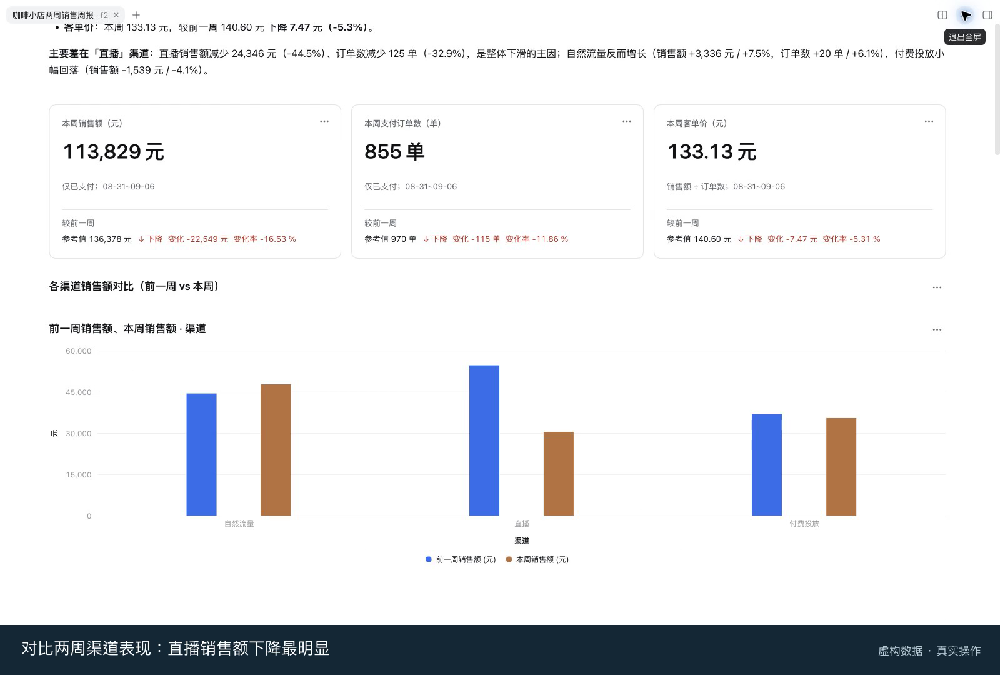

<p align="center">
  
</p>

<h1 align="center">DSH Data Analysis</h1>

<p align="center"><em>Explore data, reuse business definitions, and share analysis in DeepSeek Harness using natural language.</em></p>

<p align="center"><a href="README.md"><b>简体中文</b></a> | <b>English</b></p>

A community data analysis plugin for [DeepSeek Harness](https://github.com/deepseek-ai/deepseek-harness), powered by [Marivo](https://github.com/chengxianglibra/marivo). This independently maintained project is not an official DeepSeek product.



## Highlights

- **Natural language analysis:** explore trends, compare segments, investigate changes, and ask follow-up questions about results.
- **Files and data sources:** analyze uploaded or workspace CSV, JSON, Parquet, and Excel `.xlsx` files; connect to DuckDB, Trino, or ClickHouse and enter secrets in the credential form.
- **Reusable business definitions:** define metrics and dimensions with the assistant, browse their relationships, and reference objects by typing `@`.
- **Interactive analysis views:** present results as charts, single values, and tables; inspect exact data, ask about selected points, and revisit saved versions. Find saved reports by title in the current workspace to continue reading or editing.
- **Share results:** export offline HTML or configure object storage publishing to obtain a link to a saved view.

## Installation

### Requirements

- Node.js `^22.19.0 || >=24.0.0`.
- DeepSeek Harness `>=0.2.1-rc.2`, started and configured, with `pnpm` available on the command line.
- Python 3.10+, available as `python3` (`python` on Windows), with `venv` and `ensurepip`. Some Linux distributions require `python3-venv`.

Marivo does not need to be installed in advance. On first launch, the plugin downloads Marivo `0.6.7` and prepares the analysis environment; wait for setup to finish.

### Install and start

Install the plugin into the Harness Web Profile:

```bash
npx @deepseek-ai/dsh plugin --profile web add @chengxianglibra/dsh-data-analysis
```

Start the Web interface. If Harness is already running, exit and restart it:

```bash
npx @deepseek-ai/dsh web
```

Select a workspace, create a session, and send a message to access Datasources and credentials, Semantic layer, and Analysis views. For example:

> Analyze this month's revenue from the order data, compare it with last month, break it down by channel, and show the trend and data sources.

Enter passwords and tokens in the credential form, not in chat. Reading `.xlsx` for the first time requires an internet connection to download an extension; convert older `.xls` files to `.xlsx`, CSV, or Parquet first.

If pnpm reports `ERR_PNPM_IGNORED_BUILDS`, set `@openuidev/lang-core` to `false` under `allowBuilds` in `$DSH_HOME/profiles/web/pnpm-workspace.yaml` (under `~/.dsh/` by default), then retry. Harness peers are provided by the Host at runtime; do not install another copy of Harness or React to silence warnings.

## More information

- [Architecture and module documentation](https://github.com/chengxianglibra/dsh-data-analysis/tree/main/docs/architecture)
- [Analysis views and compatibility with older formats](https://github.com/chengxianglibra/dsh-data-analysis/blob/main/docs/architecture/modules/presentation-reader.md#分析视图目录版本历史与旧格式)
- [MIT License](LICENSE)
