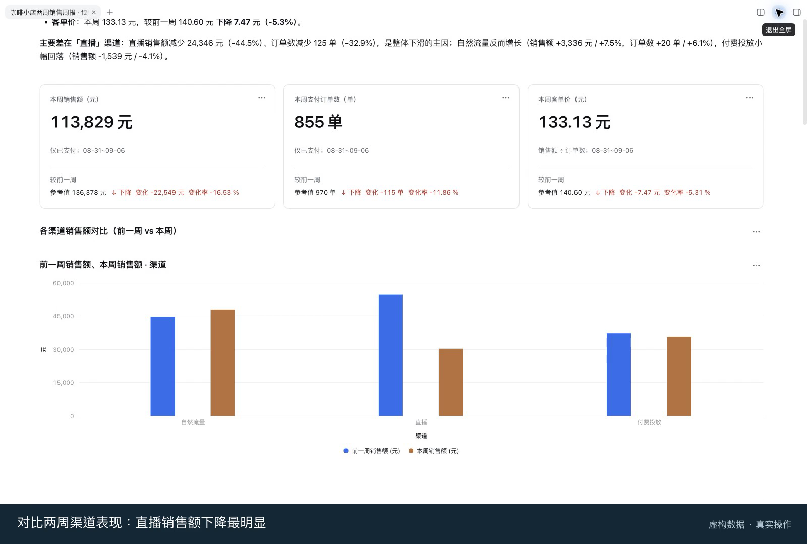

<p align="center">
  
</p>

<h1 align="center">DSH Data Analysis</h1>

<p align="center"><em>在 DeepSeek Harness 中，用自然语言探索数据、复用业务定义并分享分析结果。</em></p>

<p align="center"><b>简体中文</b> | <a href="README.en.md"><b>English</b></a></p>

[DeepSeek Harness](https://github.com/deepseek-ai/deepseek-harness) 的社区数据分析插件，分析与语义能力由 [Marivo](https://github.com/chengxianglibra/marivo) 提供。本项目由个人维护，并非 DeepSeek 官方产品。



## 功能亮点

- **自然语言分析**：针对业务问题探索趋势、比较分组和分析变化，继续追问数据与结论。
- **连接文件和数据源**：分析工作区文件或上传的 CSV、JSON、Parquet、Excel `.xlsx`；支持 DuckDB、Trino 和 ClickHouse，并通过凭证表单安全输入密码和令牌。
- **复用业务口径**：与助手整理指标和维度，在语义层浏览定义与关系，通过输入 `@` 引用对象。
- **交互式分析视图**：用图表、单值和表格展示结果，检查精确数据、选择数据点继续提问，并回看已保存的版本。可以按标题找回当前工作区已保存的报告，继续阅读或编辑。
- **分享结果**：导出可离线查看的 HTML；配置对象存储发布后，也可获取已保存视图的访问链接。

## 安装

### 环境要求

- Node.js `^22.19.0 || >=24.0.0`。
- 已启动并配置的 DeepSeek Harness `>=0.2.1-rc.2`，以及命令行可用的 `pnpm`。
- Python 3.10+，命令行可运行 `python3`（Windows 为 `python`），并支持 `venv` 和 `ensurepip`；部分 Linux 发行版需要安装 `python3-venv`。

无需预装 Marivo。首次启动会联网安装 Marivo `0.6.7` 并准备分析环境，请等待完成。

### 安装并启动

将插件安装到 Harness 的 Web Profile：

```bash
npx @deepseek-ai/dsh plugin --profile web add @chengxianglibra/dsh-data-analysis
```

启动 Web 界面；如果 Harness 已在运行，请先退出并重新启动：

```bash
npx @deepseek-ai/dsh web
```

选择工作区，新建会话并发送消息，即可使用“数据源与凭证”“语义层”和“分析视图”入口。例如：

> 使用订单数据分析本月销售额，与上月比较并按渠道拆分，展示趋势和数据来源。

密码和令牌请填写在凭证表单中，不要发送到聊天中。首次读取 `.xlsx` 需要联网下载扩展；旧版 `.xls` 请先转换为 `.xlsx`、CSV 或 Parquet。

如果安装时 pnpm 报 `ERR_PNPM_IGNORED_BUILDS`，在 `$DSH_HOME/profiles/web/pnpm-workspace.yaml`（默认在 `~/.dsh/` 下）的 `allowBuilds` 中将 `@openuidev/lang-core` 设为 `false`，然后重试。Harness peer 依赖由 Host 在运行时提供，无需为消除警告另装 Harness 或 React。

## 更多信息

- [架构与模块文档](https://github.com/chengxianglibra/dsh-data-analysis/tree/main/docs/architecture)
- [分析视图与旧格式兼容性](https://github.com/chengxianglibra/dsh-data-analysis/blob/main/docs/architecture/modules/presentation-reader.md#分析视图目录版本历史与旧格式)
- [MIT License](LICENSE)
